# SDS100 Monitor User Manual

Version 1.1.62 · by J. Lynch, developed with the help of AI (Anthropic's Claude) · [PDF with each release](https://github.com/jmlynchjr/SDS-MONITOR/releases)

Use the outline button (☰) at the top right of this file to jump to a chapter.

## About this manual

This manual describes **SDS100 Monitor version 1.1.62**, a Linux program for monitoring and controlling a Uniden SDS100 scanner from a PC over its USB cable. It runs on desktop Linux PCs and on the Raspberry Pi (chapter 25).

The chapters follow the program's menus and panels. Chapters 1 to 4 cover installing, connecting and the main window, and are worth reading first. The rest can be read as you need them.

### Conventions

- **Bold** names a button, menu item, panel or setting as it appears on screen, for example **CONNECT** or **Tools → Analyze…**.
- An arrow (→) shows a path through menus: **History → Unit ID Log…** means open the History menu and choose Unit ID Log….
- `Monospace` shows something you type, a file or folder, or a remote command sent to the scanner, such as `~/SDS100Monitor` or `GSI`.
- `~` means your home folder, for example `/home/yourname`.
- Buttons in the program are written in capitals (START, HOLD, EXPORT CSV…). An ellipsis (…) on a button or menu item means it opens a window or dialog.

> [!NOTE]
> Notes give background that helps explain why something works the way it does.

> [!TIP]
> Tips suggest a quicker or better way to do something.

> [!CAUTION]
> Cautions mark something that changes settings on the scanner or can't easily be undone.

### About SDS100 Monitor

SDS100 Monitor was created by **J. Lynch**, developed with the help of AI (Anthropic's Claude) and tested on a real SDS100. AI was also used to help write this manual.

It is **free software** under the GNU General Public License version 3 or later: you may use, share and change it under the licence's terms. The source, the releases and the version history are at **github.com/jmlynchjr/SDS-MONITOR** (**Help → Project Page**).

SDS100 Monitor is an independent program. It is not made, endorsed or supported by Uniden. Uniden, SDS100, SDS200 and Sentinel are names and trademarks of their owners. The program uses the scanner's documented remote commands (Uniden *Remote Command Specification V2.00*) and is provided as is, without warranty. Use it at your own risk.

Laws on listening to radio communications, and on recording or sharing what you hear, differ between places. You are responsible for using the scanner and this program lawfully.

## 1. Introduction

### What SDS100 Monitor does

SDS100 Monitor connects to the SDS100's USB port and reads the scanner's status several times a second. From that it can:

- show what the scanner is receiving (system, department, channel, talkgroup, unit, frequency, signal), and keep a **reception history** of every transmission with statistics;
- **control the scanner** from the PC: hold, avoid, next and previous, volume and squelch, a full on-screen keypad, the scanner's menus, a live copy of its screen, the clock, quick keys, service types and location;
- show the scanner's **waterfall** live and tune from it;
- **record each transmission** as its own MP3 through the PC's sound input, and **transcribe** the speech on this computer;
- keep a log of **radio unit IDs**, name them, and study them (profiles, fleet map, name suggestions);
- find **incidents** in the traffic, watch for **unusual activity**, search everything, and send **alerts** to the desktop or your phone;
- run the scanner's **Discovery**, **Close Call** and **Analyze** functions from the PC, with logging and extra analysis;
- compare antennas with an **Antenna Test**;
- keep the scanner's **location** updated from a GPS, and put places mentioned in calls on a **map**;
- be operated from a cheap **USB macro keypad**;
- run the scanner's **Weather Alert** and **Tone-Out** modes with alerts, and play the scanner's own **recordings**;
- look up **ten codes** by agency and location, and decode them in transcripts;
- read an ADS-B receiver (readsb or dump1090) on the same PC: **emergency squawk alerts**, watched aircraft, and **aircraft matched to callsigns** heard on airband;
- write a **daily report** of each day (window, PDF or HTML), and give each incident a one-line **headline**;
- change its look with **themes** (Dark, Light, System, Night) and text sizes;
- **install as a package** with apt, and **check for updates** itself;
- run its own **automated tests** on your PC to check that everything works.

### What you need

- A PC running Linux with **Python 3.10 or newer**. The program is developed on **Kubuntu**; the install steps here are for Kubuntu and other Debian- and Ubuntu-based systems, including **Raspberry Pi OS** (chapter 25).
- A Uniden **SDS100** and its USB cable. The program is written for the SDS100. An SDS200 may work for much of it, but isn't tested.
- Python 3 with PyQt6 and pyserial, installed from the system packages (see chapter 2).
- Optional, for some features:
  - **PC audio capture:** a cable from the scanner's headphone jack to the PC's line-in or a USB sound card, plus Qt Multimedia and `ffmpeg`.
  - **Transcription:** about 300 MB of disk for the speech engine plus the model, and `python3-venv`. An NVIDIA graphics card makes it faster but isn't needed.
  - **GPS:** a USB GPS receiver, or a phone that can send its position over Wi-Fi.
  - **Places and Map:** an internet connection, for address lookups and map tiles.
  - **Macro keypad:** a "MINI KeyBoard" USB macro pad (USB ID `1189:8890`).

### How it talks to the scanner

The SDS100's USB port appears on the PC as a serial port, usually `/dev/ttyACM0`. The program sends the scanner's remote commands over it. The main one is `GSI`, which returns a status report, and it is sent every **polling interval** (500 ms by default). Buttons and windows send other commands as needed.

> [!NOTE]
> Only one program can talk to the scanner at a time. SDS100 Monitor locks the port while it's connected and refuses to connect if another program, such as Sentinel under Wine or a terminal program, already has it open. Two programs reading the scanner at once would split its replies and corrupt both.

The SDS100's USB port carries data only, not audio. Audio for recording and transcription comes from the headphone jack (chapter 9).

## 2. Installing

### Install the package (recommended)

SDS100 Monitor is installed as a Debian package, which apt sets up together with everything it needs.

1. Download `sds100-monitor_<version>_all.deb` from the project's releases page, **github.com/jmlynchjr/SDS-MONITOR/releases**.
2. In a terminal, in the folder you downloaded it to, run:

   `sudo apt install ./sds100-monitor_1.1.62_all.deb`

   (use the version you downloaded). apt also installs PyQt6 and pyserial if they're missing, and Qt Multimedia and `ffmpeg`, which PC audio capture needs (chapter 9).

3. Start **SDS100 Monitor** from the application menu, or run `sds100-monitor` in a terminal.

The program is installed in `/opt/sds100-monitor`, with the launcher `/usr/bin/sds100-monitor`, a menu entry and icons. Your data and settings stay in your home folder (chapter 27), so they carry over from version to version and stay when the program is removed.

**Updating:** **Help → Check for Updates…** finds and installs new versions (chapter 23). You can also install a newer .deb the same way as above.

**Removing:** `sudo apt remove sds100-monitor`. Your data stays.

> [!NOTE]
> apt may print *Download is performed unsandboxed as root… couldn't be accessed by user '_apt'*. That's harmless: apt reads the file as root because its restricted user can't enter your home folder. The installation completes normally.

### Install from a folder

Without apt (or on another distribution), install the packages yourself and run the program from its folder:

1. `sudo apt install python3-pyqt6 python3-serial` (for audio capture also `python3-pyqt6.qtmultimedia ffmpeg`).
2. Extract the program's zip (or the source from GitHub) into a folder.
3. Run `bash install.sh` in that folder. It copies the program into `~/SDS100Monitor-<version>` and adds a launcher **SDS100 Monitor v<version>** to the application menu. Or simply run `python3 sds100_monitor.py` there.

> [!NOTE]
> Every folder install goes into its own folder, and never removes earlier ones. All versions share the same settings and data.

### Serial port permission

If CONNECT reports that permission was denied on `/dev/ttyACM0`, add yourself to the `dialout` group, then log out and back in:

`sudo usermod -aG dialout $USER`

The same applies to a USB GPS receiver (chapter 17).

### Removing old versions

Folder installs from before the package stay in your home folder and the application menu until you remove them. Run:

`bash /opt/sds100-monitor/cleanup_old_installs.sh`

(or `bash cleanup_old_installs.sh` in an extracted folder). This **only lists** the old installs, with their menu launchers. With the package installed, every folder install counts as old; without it, every version except the newest. Nothing is removed until you run it again with `--delete` and type the confirmation:

`bash cleanup_old_installs.sh --delete`

- To keep particular older versions as well, add `--keep` with the version, for example `--keep 24` or `--keep 1.1.14`. It can be repeated.
- Version 24 is the last version that had the database/favorites panel, so the list reminds you about `--keep 24` if it's installed.
- Your data is never touched: `~/SDS100Monitor`, `~/SDS100MonitorData`, and all CSV, HPDB and Favorites List files stay where they are.

### Optional one-time setups

These are covered in their own chapters:

- **Macro keypad:** `sudo bash /opt/sds100-monitor/install_keypad_rule.sh` (or the same script in a folder install), then unplug and replug the keypad (chapter 18).
- **Transcription engine:** installed from inside the program, with **View → Transcription… → SETTINGS… → INSTALL ENGINE**. It needs `sudo apt install python3-venv` first (chapter 10).

## 3. Connecting to the scanner

### The connection bar

The top of the main window has the connection controls:

| Control | What it does |
|---|---|
| **Port** | The scanner's serial port. The list shows the ports found; you can also type one. Usually `/dev/ttyACM0`. |
| **Baud** | Serial speed. Leave it at **115200**. |
| **Polling** | How often the scanner's status is read, from 250 to 5000 ms (default **500 ms**). Shorter catches short transmissions sooner; longer puts less load on the connection. Changes take effect at once, even while connected. |
| **Push updates** | The scanner sends its status by itself at the polling interval (`PSI`) instead of being asked each time (`GSI`): less traffic and fewer missed short transmissions. Off by default. |
| **CONNECT** | Connects, or disconnects when connected. |
| **Connect at startup** | Connects automatically when the program opens. |
| **Reconnect automatically** | Keeps trying to reconnect if the connection drops (on by default). |

1. Turn the scanner on and connect its USB cable to the PC.
2. If the scanner asks how to connect to the PC, choose the **serial port** mode, not mass storage. In mass storage mode the scanner shows up as a drive, and there's no serial port to connect to.
3. Choose the port and click **CONNECT**.

When connected, the status bar shows the scanner's model and firmware version, for example *Scanner: SDS100 • firmware …*. If the device doesn't call itself an SDS100, the status bar says so.

### Automatic reconnect

With **Reconnect automatically** ticked, the program notices when:

- the cable is unplugged,
- the scanner is turned off or restarted, or
- the scanner stops answering for 15 seconds.

It then keeps trying to reconnect, waiting 5 s, then 10 s, and up to 30 s between attempts. It finds the scanner again even if its port name changes after a replug, for example from `/dev/ttyACM0` to `/dev/ttyACM1`. While it's waiting, the CONNECT button reads **STOP RECONNECTING**.

- Clicking **DISCONNECT** yourself never starts a reconnect.
- A manual CONNECT that fails shows an error dialog. Automatic attempts report errors in the status bar instead, so dialogs don't pile up.
- With reconnect turned off, a scanner that stops answering gives a warning in the status bar.

### Push updates

With **Push updates** ticked, the status bar shows **⇣ push 250 ms** instead of **⟳ poll 250 ms**. If pushed reports stop arriving, the program asks once more (with `KAL`, keep alive), then goes back to polling and says so in the status bar's tooltip. If the scanner refuses `PSI`, it polls straight away. It stops the pushes when you disconnect.

> [!CAUTION]
> If you type `PSI` commands in the Command Console yourself, the program can't tell. Untick Push updates first, or set Polling to match.

### Commands queued at disconnect

Commands still waiting to be sent when you disconnect or close the program are sent before the port closes. For example, a key release isn't lost.

## 4. The main window

### Panels

The main window holds four panels. By default they're tabs along the bottom of the window:

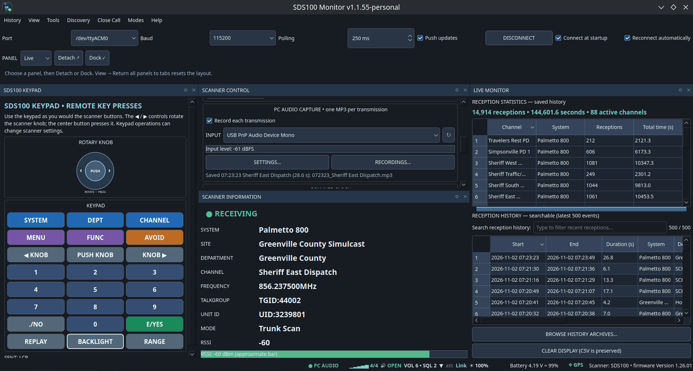

| Panel | Contents |
|---|---|
| **LIVE MONITOR** | Reception statistics and reception history (chapter 5). |
| **SCANNER CONTROL** | Hold/avoid controls, audio, recording, clock, tuning, number tags and PC audio capture (chapter 6). |
| **SDS100 KEYPAD** | An on-screen copy of the scanner's keys and knob (chapter 6). |
| **SCANNER INFORMATION** | What the scanner is receiving right now (chapter 5). |

Each panel can be:

- **dragged** by its tab or title to another place, or next to another panel;
- **detached** into its own window, and **docked** again;
- **hidden** and shown again from the **View** menu.

Right-click a panel's tab or title area for **Detach**, **Dock**, **Hide**, **Show all**, **Reset** and **Save layout**. The **View** menu has the same options for each panel, and **View → Return all panels to tabs** puts everything back the way it started. The **PANEL** selector at the top does the same job from a list.

The layout, including the size and position of detached panels, is saved when you quit.

### Separate windows

Most tools open in their own window rather than as a panel: the waterfall, the Scanner Screen, Scanner Tools, Analyze, Discovery, Close Call, Transcription and the history tools. Each window remembers its size and position. Some also reopen at start-up if they were open when you quit: the Waterfall and the Scanner Screen.

### Menus

| Menu | Items |
|---|---|
| **History** | Browse CSV archives…, Activity Charts…, Unit ID Log…, Unit Profile…, Audio Recordings…, Search Everything… (Ctrl+F), Fleet Map…, Incidents…, Daily Report…, Unit Name Suggestions… |
| **View** | Transcription…, the four panels, Detach/Dock for each panel, Scanner Screen…, Waterfall…, Scanner Tools…, Return all panels to tabs, Theme |
| **Tools** | Analyze…, Scanner Menu…, Command Console…, Scanner Screen…, Scanner Tools…, Macro Keypad…, Activity Watch…, Phone Alerts…, GPS…, Places and Map…, Ten Codes…, Antenna Test…, Aircraft (ADS-B)… (chapter 26) |
| **Discovery** | Discovery Control…, Load Sessions, Start Last Session, Exit Discovery (Resume Scan) |
| **Close Call** | Close Call Hits…, Mode: Off / Priority / Do Not Disturb, Check Current Mode, Start Close Call Only, Resume Scan, Close Call Bands…, Close Call Settings on Scanner… |
| **Modes** | Weather and Tone-Out…, Weather (Weather Scan; Weather Alert: Alert Only, SAME 1–5, All FIPS), Start Tone-Out, Scanner Recordings…, Resume Scan (chapter 20) |
| **Help** | Check for Updates…, Project Page, About SDS100 Monitor (chapter 23) |

**Ctrl+F** opens Search Everything from any SDS100 Monitor window.

### The status bar

The status bar along the bottom shows messages, the scanner's model and firmware, and a row of **indicators** read from the scanner's status report. Indicators are hidden when they don't apply. Hover over any indicator for a description; click it for related actions.

| Indicator | Meaning | Click for |
|---|---|---|
| Signal bars (0–4) | Signal as the scanner shows it | Analyze System Status |
| Squelch open / closed | Whether audio is passing | Volume and squelch controls |
| **VOL** / **SQL** | Volume and squelch levels | Volume and squelch controls |
| ▲ / ▼ | Scan direction | Scan up or down |
| **ATT** / **G-ATT** | Attenuator / global attenuator on ("att" dimmed when off) | Toggle attenuator (FUNC + 4) or global attenuator (FUNC + hold 4) |
| **KEY LOCK** | The scanner's keys are locked | — |
| **FUNC** | FUNC is active on the scanner | Cancel FUNC |
| **P25**, **DMR**, **NXDN**… | Digital mode being decoded | Analyze Current Activity |
| **IFX** | IF Exchange is on for this channel | Toggle IF Exchange (FUNC + 7) |
| ● **ALERT** | Alert LED, in its colour | Alerts or the Scanner Screen |
| ☀ backlight % | Backlight level | Backlight key or dimmer (FUNC + 5) |
| ● **REC** (red) | The scanner is recording to its SD card | — |
| ● **PC AUDIO** (green) | A transmission is being recorded on the PC | — |
| **GPS** | GPS status: green with a fix, amber waiting, red error | GPS settings |
| **Battery 4.21 V ≈ 100%** | Battery voltage and an estimated charge (red at about 15%) | — |
| **⇣ push** / **⟳ poll** | How the status is read, and how often | Polling settings |
| **⬆ Update … available** | A newer version was found (chapter 23) | Check for Updates |

> [!NOTE]
> The SDS100 (firmware 1.26.01) answers the battery command (`GCS`) with an error. After two refusals the program reads the battery voltage from the scanner's own screen instead (`Batt:4.21V`, on the trunked system information view) every 30 seconds. The percentage is an estimate from the voltage of a lithium-ion cell, and reads high while the scanner charges over USB. When the scanner's display doesn't show `Batt:` (for example while scanning conventional channels), the last reading stays; hover over it for its time.

### Right-click menus

Almost every table and value has a right-click menu. Common items are **Copy**, **Hold on this**, **Alert when this is active**, **Name This Unit…**, **Play Recording** and **Search Everything for…**. When in doubt, right-click.

## 5. Live monitoring and reception history

### Scanner Information

The **SCANNER INFORMATION** panel shows what the scanner is doing right now. At the top, a large status line reads SCANNING, RECEIVING, HOLD and so on, or DISCONNECTED. Below it are these fields:

| Field | Shows |
|---|---|
| **System** | The system name, or the scanner mode for search, Close Call and Discovery hits |
| **Site** | The trunked site, for example *Greenville County Simulcast* |
| **Department** | The department, or the search bank name |
| **Channel** | The channel or talkgroup name, or the frequency for search hits |
| **Frequency** | The frequency. For trunked calls, this is the voice frequency the call is on. |
| **Talkgroup** | The talkgroup ID, for example `TGID:44356` |
| **Unit ID** | The radio transmitting, with your name for it if you've given one, e.g. `Engine 12 (UID:3239937)` |
| **Mode** | Modulation or digital mode |
| **RSSI** | Signal strength in dBm, also shown as the bar at the bottom |

The text scales with the panel's size, and with the theme's text size (chapter 19).

Right-click the status line or any value to:
- copy a field;
- **Hold on Current Channel** or **Resume Scanning**;
- jump to reception history or the history archives.

Right-click a unit for **Name This Unit…** and the other unit actions (chapter 11).

### What counts as a reception

A **reception** is one transmission: it starts when the scanner stops on a channel or talkgroup, and ends when the channel or talkgroup changes or the signal goes. Its end is estimated as one polling interval after it was last seen.

These are all logged:

- **Stored channels and talkgroups**, with system, department, channel, frequency, talkgroup and RSSI.
- **Search and Close Call hits.** System is the scanner mode (for example *Custom Search* or *Close Call Only*), Department is the search bank name (or "—" for Close Call), and Channel is the frequency. So statistics show which frequencies were most active.
- **Discovery hits.** Department is *Discovery*. Conventional hits show "Conventional Discovery" as the system and the frequency as the channel. Trunk hits show the system name and the talkgroup name or ID.
- For trunked calls, the **voice frequency** the call was on.

### Reception statistics

The upper part of **LIVE MONITOR** shows **RECEPTION STATISTICS** from your saved history, one row per channel: Channel, System, Receptions and Total time (s). A summary line gives the total number of receptions and air time.

Right-click for:
- **Sort by Reception Count**, **Sort by Total Duration** or **Sort Alphabetically**;
- **Show Reception History for Channel**;
- copy a statistic, a row or the whole table;
- **Export Statistics to CSV…** and **Refresh Statistics**.

### Reception history

The lower part shows **RECEPTION HISTORY**, the latest 500 receptions, newest first. Its columns are Start, End, Duration (s), System, Department, Channel, Frequency, Talkgroup and RSSI (dBm). New receptions scroll the list to the newest entry.

**Search reception history** filters the list as you type; the count beside it shows how many match. Drag the divider between statistics and history to change their sizes; the split is remembered.

Right-click a reception for:
- **Copy Selected Cell**, **Search for This Channel** or **Search for This System**;
- **Hold on This Frequency** (tunes there with Quick Search Hold, chapter 6);
- **Alert When This Channel Is Active** and **Alert When This Talkgroup Is Active** (chapter 7);
- **View Reception Details…** and **Export Selected Record…**;
- **Play Recording**, if PC audio capture saved one (chapter 9);
- a submenu for each unit heard during the reception, with **Name This Unit…** and the other unit actions.

Right-click empty space for **Show All Records**, **Export Search Results…**, **Open History Archive Browser…**, **Open Today's CSV File** and **Open History Folder**.

**CLEAR DISPLAY** empties the list on screen only. The CSV files are kept.

### History files

Reception history is saved as one CSV file per day:

`~/SDS100Monitor/history/reception_history_YYYY-MM-DD.csv`

Each file has the columns Start, End, Duration (s), System, Department, Channel, Frequency, Talkgroup and RSSI (dBm). The format has stayed the same through every version, so older files keep working. Files can be opened in a spreadsheet.

- A damaged file is skipped with one warning naming it, and the others still load.
- If a save fails (for example, the disk is full), a dialog appears once, then later failures are reported in the status bar.

### Browsing archives

**History → Browse CSV archives…** (also **BROWSE HISTORY ARCHIVES…** in the panel) opens any daily CSV, or the old single history file from early versions. It shows 250 rows per page, with search and **export of matching rows**. Archives are read-only.

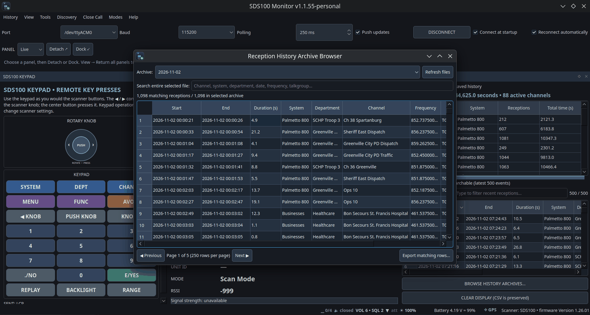

## 6. Controlling the scanner

### Scanner Control panel

The **SCANNER CONTROL** panel scrolls and has these sections. Buttons that need a connection are disabled until you connect.

#### Control

| Button | Action |
|---|---|
| **RESUME SCAN** | Resume scanning |
| **CHANNEL HOLD** | Hold on the current channel |
| **SYSTEM HOLD** / **DEPARTMENT HOLD** | Hold on the current system or department |
| **◀ PREVIOUS CHANNEL** / **NEXT CHANNEL ▶** | Move through channels while holding |
| **TEMPORARY AVOID** | Temporarily avoid the current channel (asks first, naming it) |
| **REMOVE AVOID** | Removes the avoid from the channel most recently avoided here, which the button names (asks first) |

Hold, avoid and next/previous aren't available during search, Close Call and Discovery hits, because those need a stored channel.

#### Go to number tag

Enter the **favorites list**, **system** and **channel** number tags and press **GO** (`JNT`), just like entering a number tag on the scanner. Leave a tag as — to send it blank; if the scanner refuses, fill in all three. The last tags you used are remembered.

#### Audio

**Volume** and **Squelch** sliders (0–15). They follow the scanner, so turning its knobs moves the sliders. While you're dragging a slider, the scanner's reports don't move it back, and the new value is sent once the slider stops moving.

#### Recording

Starts and stops recording on the **scanner's SD card** (`URC`). A red ● **REC** shows in the status bar while it's recording. Errors are explained in plain words: SD card error, battery too low to record, recording session limit reached, or clock lost.

This is separate from PC audio capture (chapter 9), which records on the PC.

#### Scanner clock

- **READ CLOCK** shows the scanner's date and time, the difference from the PC clock, and whether the scanner says its clock is valid.
- **SET CLOCK FROM PC** reads the scanner's daylight-saving setting and keeps it, sets the date and time, then reads the clock back to confirm. If the result is about an hour off, it says so.

> [!TIP]
> Several features need a valid scanner clock: Discovery won't start with a clock that's only temporarily set, the Analyze Activity Log needs it for its time stamps, and lining logs up with recordings is easier when the two clocks agree. Set it from the PC now and then.

#### Tune to frequency

Type a frequency and press **HOLD ON FREQUENCY** to listen there with **Quick Search Hold** (`QSH`). You can do the same from a reception: right-click it → **Hold on This Frequency**. The program checks the scanner really went to the frequency, and remembers which number format the scanner accepted.

#### Weather scan

Right-click key **6** on the keypad, or use the keypad's FUNC + hold 6 action, to start **Weather Scan** (`JPM,WX_MODE,NORMAL`).

#### PC audio capture

Records each transmission as an MP3 on the PC. See chapter 9.

### The SDS100 keypad

The **SDS100 KEYPAD** panel has the scanner's keys and its rotary knob: the three soft keys (**SYSTEM**, **DEPT**, **CHANNEL**), **MENU**, **FUNC**, **AVOID**, the knob (**◀ KNOB**, **PUSH KNOB**, **KNOB ▶**), the number keys **0–9**, **./NO**, **E/YES**, **REPLAY**, **BACKLIGHT** and **RANGE**. Clicking a key sends it to the scanner as a key press.

Right-click any key for:
- a normal press;
- **FUNC + press**;
- **FUNC + long press**, where the scanner has one;
- a **keypad reference** describing what the key does.

Long-press actions for 4, 8, 9, AVOID and REPLAY were tried on the scanner and are labelled as user-tested.

#### Keypress Protocol Diagnostic

Right-click a key → **Keypress Protocol Diagnostic** opens an experimental tool for sending single `KEY` commands with the press, long, hold and release modes. It has a preview, an acknowledgement checkbox, extra confirmation for long and hold, a reply log and a manual release. Long, hold and release aren't documented in Uniden's remote command specification, so use it only for experiments. A key held from the diagnostic is released when you disconnect or close the program.

### Scanner Screen

**View → Scanner Screen…** (or **Tools → Scanner Screen…**) opens a live copy of the scanner's display in its own window.

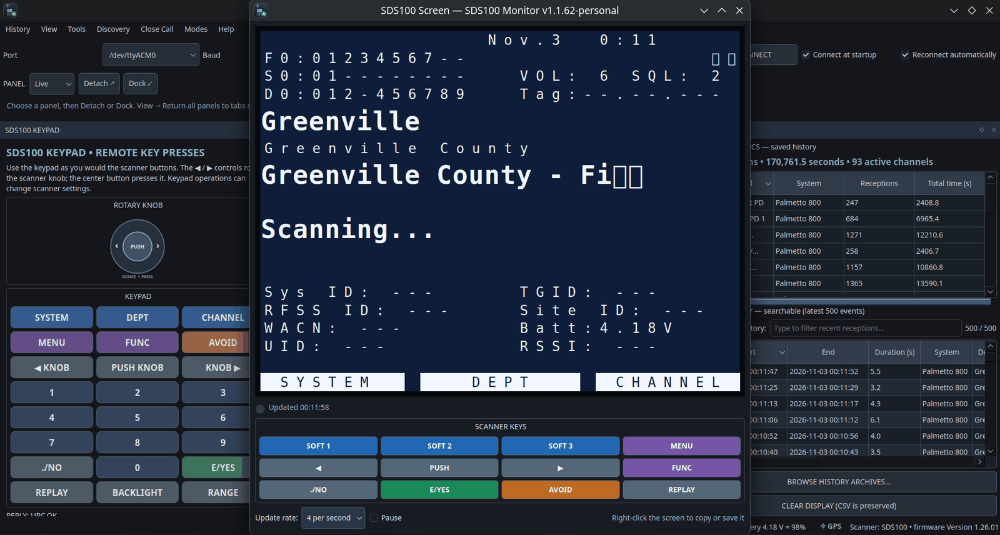

- It shows every text line, large and small lines, highlighted and underlined characters, and the scanner's colour mode (colour, black or white background).
- The **alert LED** is shown as a coloured dot under the screen. The status line says when the scanner is in a menu, direct entry or waterfall mode.
- Keys under the screen: SOFT 1–3, MENU, knob ◀ / PUSH / ▶, FUNC, ./NO, E/YES, AVOID and REPLAY. You can work through the scanner's menus from the PC while watching the result.
- **Update rate** 4, 2 or 1 per second (default 2), and a **Pause** box. The screen is only read while the window is open and not paused.
- Right-click the screen to **copy its text** or **save it as a PNG image**.

The window reopens at start-up if it was open when you quit. If the scanner refuses the screen command (`GST`), the window uses `STS` instead, which gives the same display without the LED.

### Scanner Menu

**Tools → Scanner Menu…** works the scanner's own menus as a list instead of with keys.

- **Open a menu:** main menu, Settings, Select lists to monitor, Close Call, Close Call bands, Search options, Weather and Broadcast screen. It can also open the current system's, department's, site's or channel's options, or a custom search range or Tone-Out channel by number.
- The window shows the menu title and all its items, with the current choice ticked. The scanner sends a long menu in parts (*Select lists to monitor* with many Favorites Lists, for example); the parts are joined, so every item is listed in the scanner's order. **SELECT** (or double-click) chooses an item, and the list shows the new value as soon as the scanner replies. Menus that ask for text or a number get an entry box showing the allowed length.
- In *Select lists to monitor*, each **SELECT** switches a list **On** or **Off**. Wait for the value to change before selecting the same list again, or the second press switches it back.
- **BACK** goes up a level, **EXIT MENU** leaves the menus and closes the window once the scanner is back to scanning, and **REFRESH** reads the menu again.
- **Follow the scanner** re-reads the menu every second, so the window keeps up when keys are pressed on the scanner or in the Scanner Screen.
- **SHOW XML** shows the scanner's last menu reply exactly as it was received.

> [!CAUTION]
> Choices made here change the scanner's settings, exactly as if you made them on the scanner.

> [!NOTE]
> After you change the lists to monitor and leave the menu, the SDS100 can take several seconds to load them, and doesn't answer in the meantime. Give it a moment before pressing BACK or EXIT MENU again.

### Command Console

**Tools → Command Console…** sends any remote command and shows the raw replies. It's mainly for checking what the scanner sends back.

- Type a command and press **Enter**. ↑ and ↓ recall earlier commands; the last 100 are remembered.
- A drop-down offers read-only commands such as `MDL`, `VER`, `GSI`, `GST`, `DTM`, `LCR`, `VOL`, `SQL`, `SVC`, `FQK`, `MSI` and `GLT`.
- The log shows → sent, ← replies (refusals in red) and ⋯ XML documents, with time stamps.
- Options:
  - **Program's own commands** also shows commands sent by the rest of the program.
  - **XML replies** shows status reports, lists, menus and Analyze data.
  - **Status polls** also shows the regular background `GSI` polls, which arrive several times a second.
- **COPY**, **SAVE…** and **CLEAR**.
- Commands that change things, such as `POF` (power off), `KEY`, `AVD`, `MSV`, `URC`, and `DTM`/`LCR`/`SVC` with values, ask once per session before sending.
- `AST,RAW_DATA_OUTPUT` is refused, because it streams binary data that would flood the connection.

> [!TIP]
> To show what the scanner sends during a feature that isn't working as expected, tick **XML replies** (and **Status polls** if needed), use the feature for a few seconds, then **SAVE…** the log.

## 7. Scanner Tools

**View → Scanner Tools…** (or **Tools → Scanner Tools…**) opens a window with five tabs.

### Lists

1. Click **LOAD FAVORITES LISTS**.
2. Expand a favorites list to see its systems, then departments or sites, then channels or talkgroups. Each level is read from the scanner when you expand it.

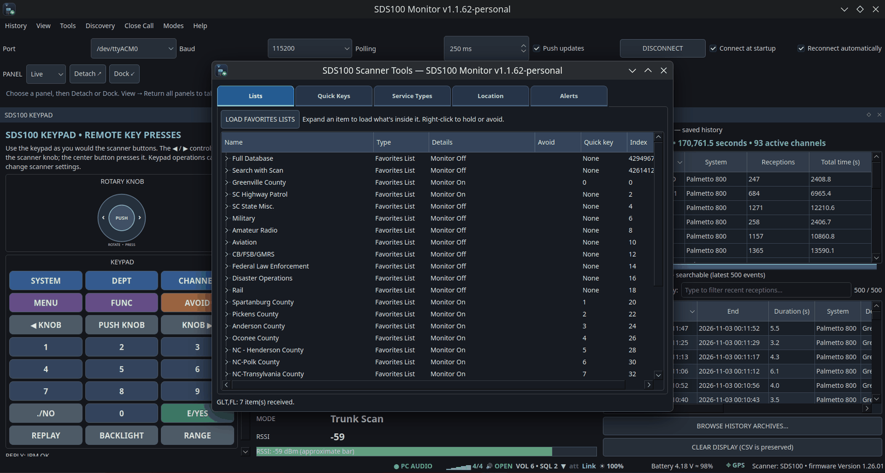

Right-click any system, department, site, channel or talkgroup to:
- **hold** on it;
- **temporarily avoid** or **permanently avoid** it (asks first);
- **remove an avoid**;
- add an **alert** for it.

This works for any item in the lists, not just the one on screen. The avoid column shows each item's current state, and the list refreshes after a change.

### Quick Keys

Favorites list, system and department **quick keys** are shown as 10 × 10 grids: green means enabled, grey disabled, and blank not assigned. Click a key to turn it on or off. Choose which favorites list and system the lower grids show. Favorites list names appear in tooltips once the Lists tab has loaded them.

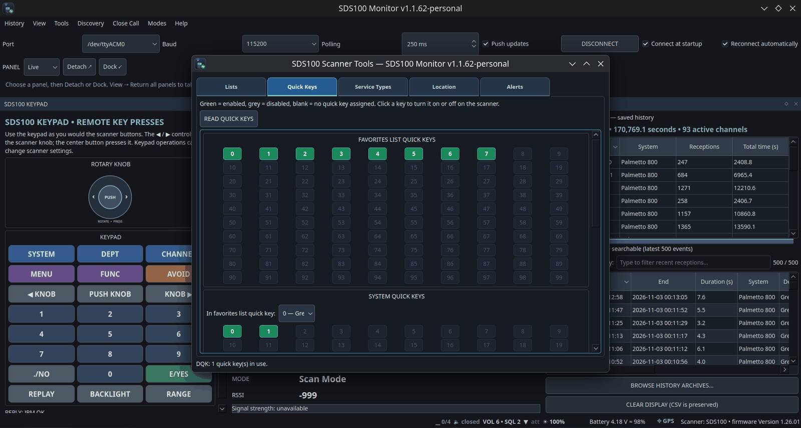

### Service Types

The 30 preset and 10 custom **service types** as checkboxes. **READ** them from the scanner, change them, then **APPLY**. **ALL ON** and **ALL OFF** are shortcuts.

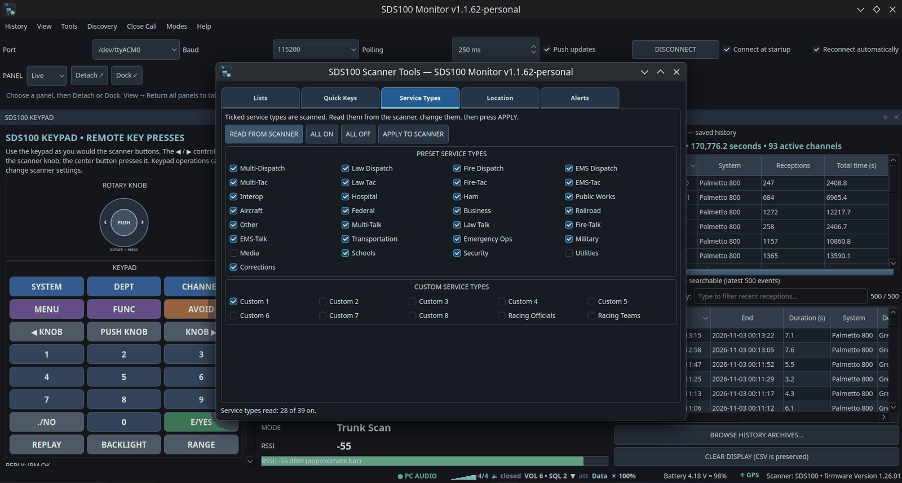

### Location

Read and set the scanner's **latitude, longitude and range** (`LCR`). The scanner must be read first, so the program can send changes in the same number format; it reads back to confirm.

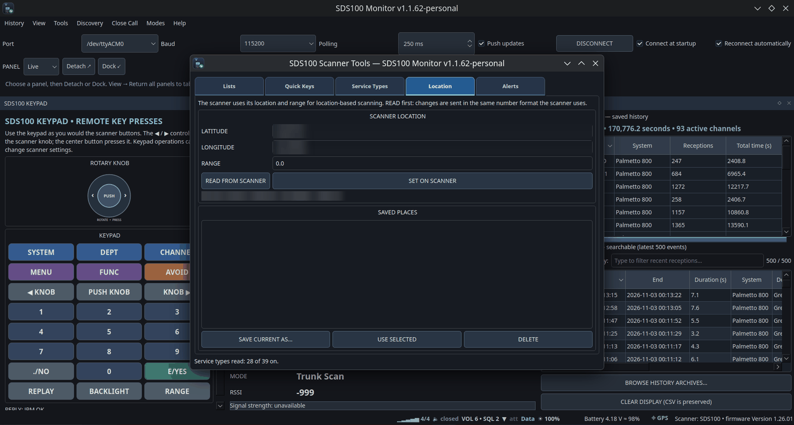

**Saved places** store locations by name. Double-click a saved place to send it to the scanner. Saved places also count as landmarks for Places and Map (chapter 17).

To keep the location updated automatically as you move, use GPS (chapter 17).

### Alerts

Alert rules raise a **desktop notification** and a **sound** when a matching reception happens. Examples:

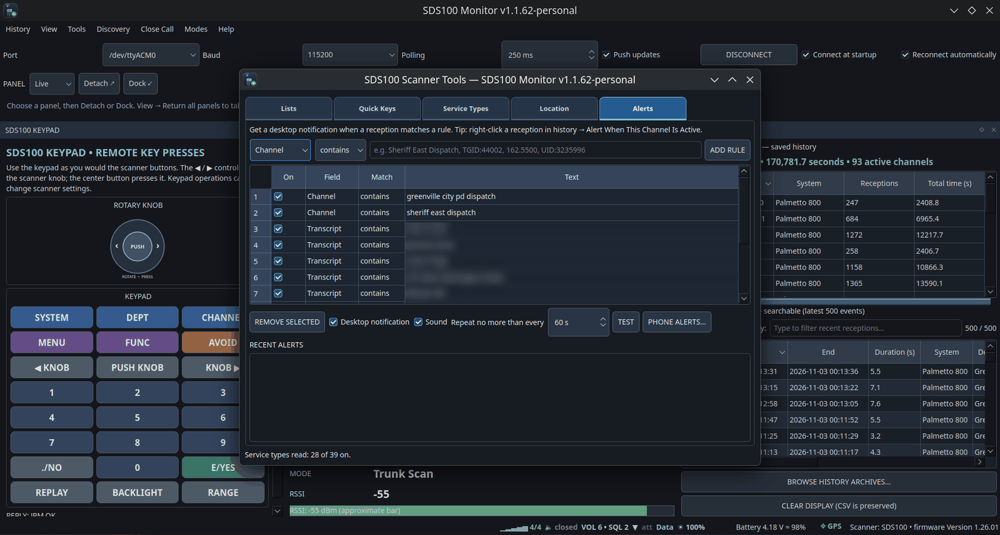

- *Channel* is *Sheriff East Dispatch*
- *Talkgroup* is *TGID:44002*
- *Unit ID* contains *3235996*
- *Transcript* contains *structure fire* (needs transcription, chapter 10)
- *Any field* contains *Fire*

Each rule alerts at most once per reception, and no more often than the **repeat interval** you choose (default 60 s). Rules can be switched off without deleting them. The last 50 alerts are listed under **Recent alerts**.

Quick ways to add a rule:
- right-click a reception → **Alert When This Channel / Talkgroup Is Active**;
- right-click a channel in the Lists tab;
- right-click a unit → **Alert When This Unit Is Heard**;
- right-click a call in Transcription → **Alert When Transcript Contains…**.

Unit rules with "is exactly" match on the unit number, so they keep working after you name the unit. To send alerts to your phone as well, see Phone Alerts in chapter 12.

## 8. Waterfall

**View → Waterfall…** opens the waterfall in its own window, which can be moved, resized and maximized. The live graph is on the left and takes any extra space. The controls are in a column on the right, with a draggable divider between them. The window reopens at start-up if it was open when you quit.

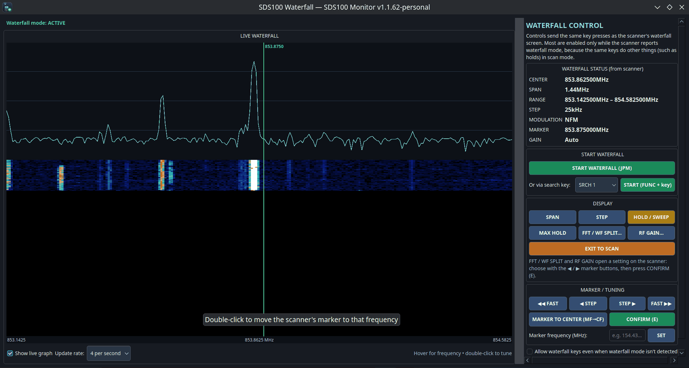

### Starting the waterfall

The waterfall is a scanner mode. There are two ways to start it from the program:

- **START WATERFALL (JPM)** sends `JPM,WF_MODE,0`. Uniden's specification marks this command's index as reserved, so it may not work on all firmware; the reply shows in the panel.
- **START (FUNC + key)** uses the documented method. First, on the scanner, assign Waterfall to a search key: Menu → Search for → Set Search Key → Search Key *n* → Waterfall. Then pick that key in the program and press **START**.

### Live graph

While the scanner is in waterfall mode, the graph shows the current signal trace at the top and a scrolling waterfall below it. The marker is drawn in green, and the lower, centre and upper frequencies are along the bottom.

- **Update rate:** 4, 2 or 1 frames per second. Data is only requested while the window is open.
- **Contrast** adjusts automatically to the noise floor.
- The history clears when the span or centre frequency changes, so old rows never line up with the wrong frequencies.
- **Click to tune:** hover over the graph to see a frequency, and double-click to move the scanner's marker there. It's rounded to the current step.

### Controls

| Section | Controls |
|---|---|
| **Waterfall status** | Centre frequency, span, range, step, modulation, marker frequency and RF gain, read from the scanner |
| **Display** | SPAN, STEP, HOLD / SWEEP, MAX HOLD, FFT / WF SPLIT, RF GAIN, EXIT TO SCAN |
| **Marker / tuning** | Step and fast tuning, MARKER TO CENTER, CONFIRM (E), and a marker-frequency box that enters a frequency and presses E |

Frequencies outside the SDS100's coverage are rejected before anything is sent.

> [!CAUTION]
> In scan mode the soft keys act as System, Department and Channel hold. So all controls except START are enabled only while the scanner reports waterfall mode. If detection ever fails, a checkbox enables them anyway. Use it with care.

In Night mode (chapter 19) the waterfall uses a black-to-red colour scale.

## 9. PC audio capture and recordings

PC audio capture records the scanner's audio through your PC's sound input and saves **each transmission as its own MP3**, tagged with the reception details. Audio between transmissions is never saved.

### Setup

1. Connect the SDS100's **headphone jack** to the PC's **line-in** or a **USB sound card**. The scanner's USB port carries only the serial connection, not audio.
2. Make sure `python3-pyqt6.qtmultimedia` and `ffmpeg` are installed (chapter 2). If either is missing, the panel says which.
3. In **SCANNER CONTROL → PC AUDIO CAPTURE**, choose the input.
4. Set the level. The level meter works even without a scanner connection. Adjust the scanner's volume so speech peaks at about **−12 to −3 dBFS**.
5. Tick **Record each transmission**.

> [!TIP]
> Recording follows the scanner's volume knob, so leave it at the same setting once the level is right.

### How transmissions are cut

A recording starts and ends with the same receptions that go into reception history, one per channel or talkgroup change.

- **Pre-roll** (default 1.5 s): the scanner is polled, so a transmission is noticed up to one polling interval late. Pre-roll keeps the audio from just before it was noticed, so first words aren't cut off.
- **Post-roll** (default 1.0 s) keeps recording briefly after a transmission ends.
- When one transmission follows another directly, the first file ends where the next begins, so no audio is in both.
- **Not saved:**
  - receptions shorter than the **minimum length** (default 1 s);
  - recordings whose loudest moment is below the **silence level** (default −50 dBFS), such as encrypted calls or an unplugged cable.

  The panel shows why a reception was skipped.
- A transmission in progress when you close the program is saved before it exits.

**SETTINGS…** in the panel sets pre-roll, post-roll, minimum length, MP3 bitrate (default 48k), mono and silence level.

While a transmission is being recorded, the status bar shows a green ● **PC AUDIO**.

### Files and tags

MP3s are saved in a folder per day, named by start time and channel:

`~/SDS100Monitor/audio/YYYY-MM-DD/225412_Sheriff East Dispatch.mp3`

**ID3 tags:**
- title = time + channel;
- artist = system;
- album = department;
- the date;
- genre *Scanner*;
- a comment with frequency, talkgroup, site, unit IDs, mode and RSSI.

The same fields are also stored separately (START, END, DURATION, SYSTEM, DEPARTMENT, CHANNEL, FREQUENCY, TALKGROUP, SITE, UNIT_IDS, MODE, RSSI) for players and tools that read custom tags.

**Recordings index:** `recordings_YYYY-MM-DD.csv` in the same folder has one row per recording: Start, End, Duration (s), System, Department, Channel, Frequency, Talkgroup, Site, Unit IDs, Mode, RSSI (dBm), Audio Length (s) and Audio File.
- Start, End and Duration match the reception history row.
- Audio Length includes pre-roll and post-roll.
- Unit IDs lists every unit heard during the transmission, with your names for them.

### Playing recordings

- **History → Audio Recordings…** (or **RECORDINGS…** in the panel): choose a day, search, and double-click to play in your default audio player. New recordings appear while the window is open.
- Right-click a reception in history → **Play Recording**.
- Recordings can also be played from Transcription, unit profiles, Search Everything, Incidents, Places and Close Call.

## 10. Transcription

**View → Transcription…** shows what was said on each recorded call, newest at the top, as calls come in. It transcribes the MP3s from PC audio capture, so capture must be set up first (chapter 9).

Transcription runs **on this computer, offline**, using the Whisper speech engine (faster-whisper). No audio leaves the PC, and there's no account or cost.

### One-time setup

1. Install the Python environment tools: `sudo apt install python3-venv`
2. Open **View → Transcription… → SETTINGS…** and click **INSTALL ENGINE**.

   This downloads faster-whisper (about 300 MB) into `~/SDS100Monitor/transcribe-engine`, a separate Python environment, so nothing else on the system changes.

   If you have an NVIDIA graphics card, tick **Include NVIDIA GPU support** before installing (about 3 GB more). If the GPU won't run, the engine switches to the CPU by itself.
3. The chosen model downloads the first time it's used. The status line shows progress.

### Models

| Model | Use |
|---|---|
| **Small (English)** | The default. A good balance of speed and accuracy on a CPU. |
| **Base**, **Tiny** | Faster, for an older PC. Base uses about half the memory of Small. |
| **Medium** | More accurate, but slow without a GPU. |
| **Large v3**, **Distil large v3** | Meant for an NVIDIA GPU. |

Change the model, language and beam size in **SETTINGS…**; the engine restarts with the new settings.

#### Memory

The status line shows how much memory the engine is using, for example *Ready: small.en on CPU • using 1.1 GB*. To free memory, the model **unloads after 5 minutes without calls**: in SETTINGS…, **Unload the model after** can be changed, or set to *Never*. The next call loads it again, which takes a few seconds. A call that arrives while the model is unloading isn't lost.

### Vocabulary

List the names and words your agencies use, such as unit names, station names, streets and codes like 10-4. Whisper will then expect them. The call's channel, department and system names, and your unit names, are added automatically. **This makes the biggest difference to accuracy.**

### The Transcription window

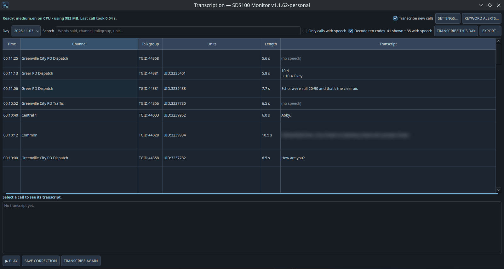

- The list shows time, channel, talkgroup, units (with your names), length and transcript.
- **Transcribe new calls** transcribes every new MP3 automatically; untick it to stop.
- **TRANSCRIBE THIS DAY** does a day's older recordings. New calls go ahead of them.
- **Search** covers the words said, as well as channel, talkgroup and unit.
- **Only calls with speech** hides recordings where nothing was understood.
- Double-click a call, or select it and press **▶ PLAY**, to listen.
- Select a call to read it in large type below the list. Fix mistakes there and press **SAVE CORRECTION**; the model column then says *(corrected)*.
- **TRANSCRIBE AGAIN** redoes one call, for example after changing the model or vocabulary.
- **EXPORT…** saves the current view as CSV, or as plain text with one line per call.
- **Decode ten codes** shows the meaning of ten codes heard in a call under its transcript, using the list for that call's agency and your location (chapter 21), for example *10-50 B → Motor vehicle accident — B. Personal injury*. Hover over a transcript for which list each meaning came from.

**Keyword alerts:** add an alert with the **Transcript** field, for example *Transcript contains "structure fire"*. You'll get a notification like *Heard "structure fire" on Fire Dispatch*, with what was said. Add one from **KEYWORD ALERTS…**, or right-click a call → **Alert When Transcript Contains…**; any text you've selected in the transcript is filled in.

### Files

`~/SDS100Monitor/audio/YYYY-MM-DD/transcripts_YYYY-MM-DD.csv`, beside the day's MP3s, with the columns Start, System, Department, Channel, Talkgroup, Unit IDs, Audio Length, Audio File, Transcript, Model and Transcribed. The MP3s and the recordings index aren't changed.

> [!NOTE]
> Whisper sometimes "hears" words in noise. Transcripts that are only a known phantom phrase (such as *"Thank you."*) are dropped, and so are segments Whisper itself marks as probably not speech. Digital voice (P25, DMR) and weak signals transcribe less well than clear analog audio.

## 11. Radio units

The SDS100 reports a P25 or DMR radio's **unit ID** (UID) number, but not the name some radios send over the air (talker alias). SDS100 Monitor keeps a log of every unit heard, lets you name units, and has tools to help work out which ID is which.

### Unit ID Log

Every unit heard is logged, one row each time a different unit transmits:

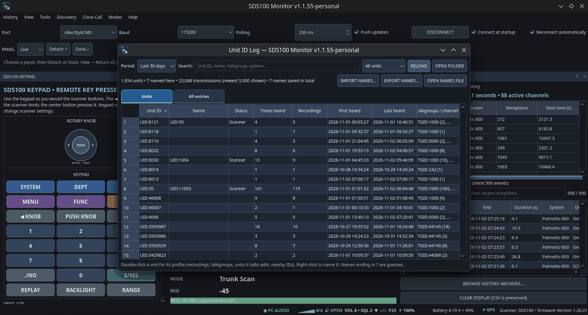

`~/SDS100Monitor/unit_ids/unit_ids_YYYY-MM-DD.csv`

The columns are time, unit ID, the scanner's name for the unit, system, site, department, channel, talkgroup and frequency.

**History → Unit ID Log…** shows it in two views:

- **Units:** a summary per unit, with times heard, first and last heard, main talkgroups, and the Name, Status and Recordings columns.
- **All entries:** every logged transmission.

There's a **period** filter (Last 30 days by default; changing it reloads), a search box, and a filter for **All units**, **Unnamed only**, **Guesses only** or **Confirmed only**. Double-click a unit to open its profile.

### Naming units

Right-click a unit almost anywhere and choose **Name This Unit…** (or **Rename This Unit…**). This works in Scanner Information, the Unit ID Log, reception history, Audio Recordings, unit profiles, Search Everything, Incidents, Fleet Map, Found IDs and Analyze. Give it:

- a **name**, for example *Engine 12*;
- a **status**: **Confirmed**, or **Guess** when you're not sure;
- optional **notes**.

The same right-click menu has **Unit Profile…**, **Alert When This Unit Is Heard** and **Copy Unit ID**.

Names then show everywhere: Scanner Information, logs, alerts, MP3 tags, the recordings index, Discovery hits and Analyze. They appear as `Engine 12 (UID:3239937)`, and guesses carry a question mark: `Medic 4? (UID:3239940)`. A name given in the Monitor takes priority over a name programmed in the scanner. The unit ID log CSV still records the scanner's own name, so its format doesn't change.

Names are stored in `~/SDS100Monitor/unit_names.csv`, which you can also edit in a spreadsheet.

**Importing and exporting:** in the Unit ID Log, **IMPORT NAMES…** reads a CSV with unit ID and name columns. Headings such as *Unit ID*, *UID* or *Radio ID* and *Name* or *Alias* are recognised. Without headings, the ID is the first column and the name the second. If an imported unit already has a different name, it asks before replacing it. **EXPORT NAMES…** and **OPEN NAMES FILE** are beside it.

### Unit profile

Double-click a unit in the Unit ID Log, or use **History → Unit Profile…** and type an ID. The profile has:

- **Recordings:** every saved recording that includes the unit, newest first. Double-click a recording, or press **PLAY NEWEST**. Units often say who they are on the air, so this is usually the fastest way to identify one. A recording can also include other units that keyed up during the same transmission.
- **Talkgroups:** where the unit talks, how often, and when it was last heard.
- **Activity:** transmissions by hour of day and day of week.
- **Talks With:** other units heard on the same talkgroup or channel within 60 seconds. A dispatch console talks with almost everyone.
- **Nearby IDs:** units numbered within 100 of this one, heard or named. Agencies often number their radios in blocks.
- Name, status and notes can be edited at the top. **ALERT WHEN HEARD** adds an alert rule for the unit.

### Unit Name Suggestions

**History → Unit Name Suggestions…** learns radio names from transcripts (chapter 10).

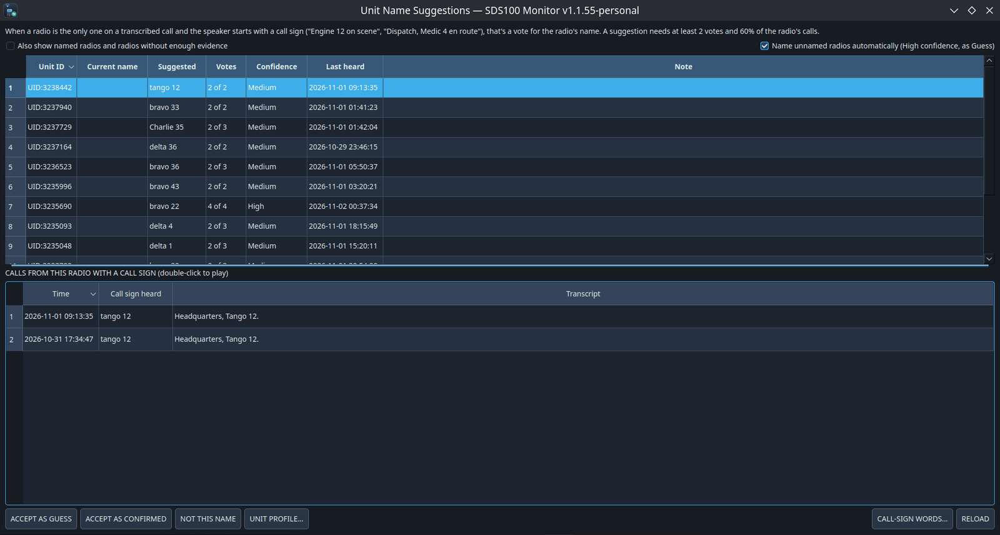

- When a radio is the only one on a transcribed call, and the speaker starts with a call sign (*"Engine 12 on scene"*, *"Dispatch, Medic 4 en route"*, *"Engine one two available"*), that counts as a vote for that radio's name.
- A suggestion needs **2 votes** and **60%** of the radio's call-sign calls. **High** confidence is 4 or more votes and 80% or more.
- A radio that gives several different call signs is marked *probably a dispatcher or a shared radio* and gets no suggestion.

Buttons:
- **ACCEPT AS GUESS** or **ACCEPT AS CONFIRMED** names the radio; the notes say how many calls the name came from.
- **NOT THIS NAME** stops that suggestion for good.
- **UNIT PROFILE…** opens the radio's profile.
- **CALL-SIGN WORDS…** sets the words that start a call sign (Engine, Medic, Car, Adam, Deputy Chief…). A number must follow, in digits or words.

The lower list shows the calls behind a suggestion; double-click one to listen. New suggestions appear in the status bar as calls are transcribed. **Name unnamed radios automatically** (off by default) names High-confidence radios as Guess. Names you've given yourself are never replaced.

### Fleet Map

**History → Fleet Map…** sketches which agency, unit type or shift each radio belongs to, from the unit ID log for the last 7, 30 or 90 days, or everything.

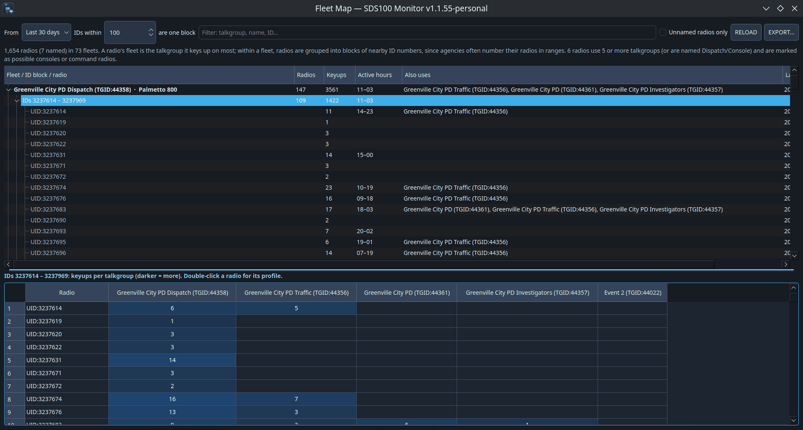

- **Fleets:** a radio's fleet is the talkgroup it keys up on most. Each fleet shows how many radios it has, its keyups, its **active hours** (the hours holding 90% of its traffic, such as 07–15), other talkgroups it uses, when it was last heard, and the first word of its named radios (e.g. *Engine*).
- **ID blocks:** within a fleet, radios are grouped into blocks of nearby ID numbers (within 100, adjustable). Blocks with different active hours often mean different shifts or units. For example, IDs 20100–20107 might be active 07–15 and 20500–20505 active 15–06.
- **Radios:** each shows its ID and name (the scanner's own name in [brackets] if you haven't named it), keyups, active hours and other talkgroups. Unnamed radios show the nearest named radios in their block (*near Engine 12, Engine 15*) as a hint. Radios on 5 or more talkgroups, or named Dispatch or Console, are marked *console / command radio?*.
- **Talkgroup grid:** select a fleet, block or radio to see its radios against the talkgroups they use, shaded by keyups.

Double-click a radio for its profile. Right-click to name it or search for it, or to copy a block's radio IDs. There's a filter box, an **Unnamed radios only** option, and **EXPORT…** to CSV.

## 12. History analysis and alerts

### Activity Charts

**History → Activity Charts…** shows:

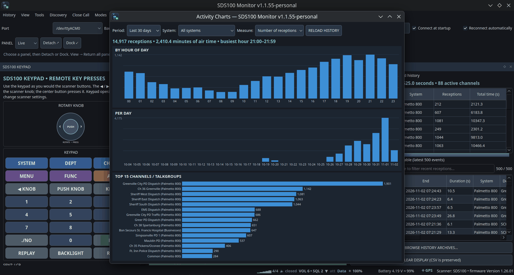

- receptions by hour of day;
- receptions per day (per month for long periods);
- the top 15 channels or talkgroups.

The period can be the last 7, 30, 90 or 365 days, or all history. You can filter by system and measure by number of receptions or by air time. Hover over a bar for its value.

### Search Everything

**History → Search Everything…**, or **Ctrl+F** from any SDS100 Monitor window, searches reception history (calls), transcripts, radios and incidents at once. Each kind of result gets its own tab, with a count.

- All words must match, in any field. Use quotes for a phrase: `"main street" fire`.
- Talkgroup IDs, frequencies, channel names, unit IDs (`UID:3239937`), unit names and their notes all work.
- Searching by a unit's name also finds the transcripts and incidents that only recorded its number, as long as you've named it.
- **Range:** Today, Last 7, 30 or 90 days, or Everything (remembered). Incidents are searched for the last 14 days of the range.
- Up to 2,000 results of each kind are shown; the tab shows "+" when there are more.
- Double-click a result:
  - a call plays its recording (or shows its details if there isn't one);
  - a transcript plays its call;
  - a radio opens its unit profile;
  - an incident opens Incidents at that incident.

  Right-click for more.

### Incidents

**History → Incidents…** joins calls into **incidents** and shows each as a timeline. It uses reception history, the unit ID log and transcripts.

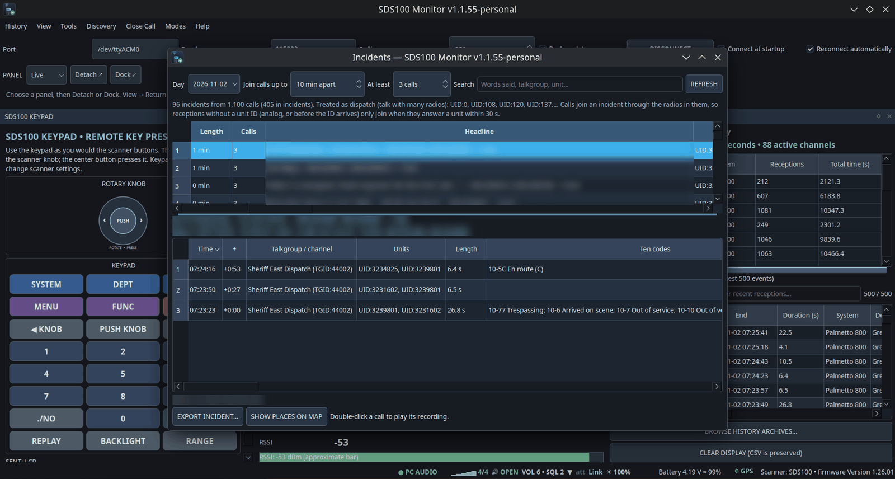

**How calls are joined:**
- Two calls belong together when the same radio is in both, up to **10 minutes** apart (adjustable).
- They also belong together when they follow each other on a talkgroup within 30 seconds and a field unit is in one of them (dispatch, then a unit answering).
- An incident needs **3 calls** (adjustable).

**Dispatch radios:** dispatch consoles talk with nearly every radio, so they would join everything. A radio is treated as dispatch if:
- it is heard with 6 or more different radios **and** is on at least 15% of the calls on a busy talkgroup; or
- you've named it with *Dispatch*, *Console*, *Comm*, *Control*, *911*, *ECC* or *Base*.

The window lists which radios it treated as dispatch.

**The incident list** shows start, length, calls, a **headline**, units, talkgroups, notes (such as *units moved to Fireground 2* or *more than one agency*) and what was said (the first transcribed call, usually the dispatch).

**Headlines** sum an incident up in one line, for example *10-50B Motor vehicle accident — B. Personal injury — Wade Hampton at Pleasantburg — Engine 12, Medic 4 — 7 min*:
- **what happened:** the first ten code in the calls that isn't routine (routine means codes such as *in service*, *en route* or *on scene*, chapter 21), otherwise the start of what was said, otherwise the talkgroups;
- **where:** the first place mentioned (chapter 17);
- **who:** up to three units, with your names;
- **how long.**

Select an incident to see its timeline: time, +minutes, talkgroup, units, length, the **ten codes** decoded in each call, and the transcript. Below the timeline are the **places** mentioned in the incident's calls; **SHOW PLACES ON MAP** opens the map on them, even for an older day. Double-click a call to play it, and right-click for unit names and profiles. Search covers headlines, words said, talkgroups and units. **EXPORT INCIDENT…** saves an incident as text or CSV, with its headline and codes. Today's incidents refresh every minute.

> [!NOTE]
> Calls with no unit ID (analog calls, or calls that ended before the ID arrived) only join an incident when they answer a unit within 30 seconds. So incidents work best on P25 and DMR systems.

### Activity Watch

**Tools → Activity Watch…** learns each talkgroup's normal traffic and alerts when something is different.

- **Unusual activity:** each talkgroup's or channel's calls in the last **15 minutes** (10, 15 or 30) are compared with its normal for that hour of the day, learned from the last **28 days** (14, 28, 56 or 90). Hours when the Monitor wasn't running don't count as quiet. **Sensitivity** Low, Medium or High alerts at 4×, 3× or 2× normal (and well above the usual variation), with at least **6 calls**. Each talkgroup alerts at most once per 30 minutes.
- **First heard:** a talkgroup, channel or radio heard for the first time in your history.
- **Back after a quiet spell:** a radio not heard for **30 days** (adjustable). New radios can arrive in bursts (mutual aid, a new fleet), so they give at most one notification a minute; the rest go to the log.

The window lists everything heard in the last few minutes, most unusual first, with calls now, normal for now, and a state: UNUSUAL, busy, normal or learning. A log of activity alerts is below. Alerts start once there are **7 days of history**, and normal levels are re-learned each day.

**Ignore list:** busy channels such as dispatch can be left out. Right-click a talkgroup → **Ignore …**, or use **IGNORE LIST…** and type:
- a talkgroup ID (`TGID:44002` or `44002`);
- a channel name; or
- a word in the name. **Dispatch** ignores every channel with *Dispatch* in its name, including ones heard for the first time later.

Ignored talkgroups give no unusual-activity or new-talkgroup alerts, and are greyed in the table. New and returning radios on an ignored talkgroup still alert, unless you tick **No radio alerts from ignored talkgroups either**. Right-click → **Alert for … Again** removes the entry that covers a talkgroup.

Activity alerts use the Alerts settings (desktop notification, sound) and appear in **Recent alerts**.

### Phone Alerts

**Tools → Phone Alerts…** (also **PHONE ALERTS…** in Activity Watch and Alerts) sends alerts to your phone as **push notifications**.

> [!NOTE]
> Ordinary text messages aren't offered. The major US carriers have shut down or are phasing out their email-to-text gateways, and sending real SMS needs a registered business account. Push notifications arrive on the lock screen the same way.

Choose a service:

| Service | Setup |
|---|---|
| **ntfy** (recommended, free, no account) | Install the ntfy app (Android or iPhone), tap +, and subscribe to the topic shown, a random name such as `sds100-3f9a1c7e2b`. Keep it random: anyone who knows a topic name can read it. Priority Normal, High (default) or Urgent; on Android, Urgent can break through Do Not Disturb. A self-hosted ntfy server with an access token works too. |
| **Pushover** | Application token and user key. |
| **Telegram** | Bot token from @BotFather. Send your bot `/start`, then **FIND CHAT ID** fills in the chat ID. |
| **Email** | Any SMTP server. For Gmail: `smtp.gmail.com`, port 587, STARTTLS and an app password. |

**What goes to the phone:** unusual activity, new talkgroups and keyword alerts are on by default. New radios, returning radios, Close Call alerts, **Aircraft** (emergency squawks and watched aircraft, chapter 26) and other alert rules can be added.

**Limits:** no more than **20 an hour** (adjustable), and optional **quiet hours** such as 22:00 to 07:00. Alerts still show on the PC during quiet hours and over the limit.

**SEND TEST MESSAGE** tries the settings before you save them, and shows the service's reply if it fails. Alerts that fail to send are reported in the status bar.

> [!CAUTION]
> Settings, including tokens and passwords, are stored in the program's settings file in your home folder (`~/.config/SDS100Monitor/`).

## 13. Discovery

The SDS100's **Discovery** mode looks for active frequencies (Conventional Discovery) or talkgroups (Trunk Discovery) in a range or system. You set up sessions on the scanner; SDS100 Monitor starts them, follows what they find, and logs the hits.

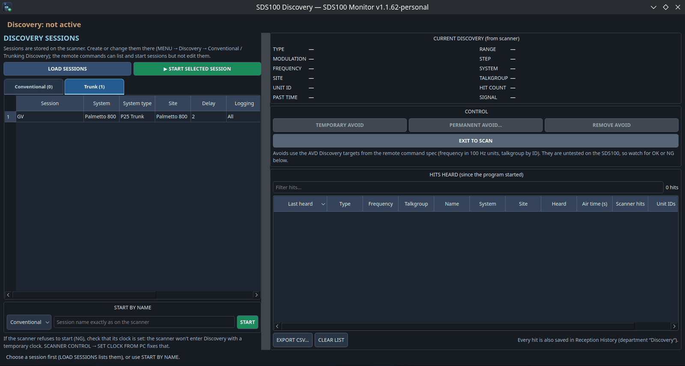

### The Discovery menu

- **Discovery Control…** opens the Discovery window.
- **Load Sessions** opens the window and reads the session lists from the scanner.
- **Start Last Session: …** restarts the session you last started from the program.
- **Exit Discovery (Resume Scan)** returns the scanner to scanning.

### Sessions

Sessions are created and changed **on the scanner**, under MENU → Discovery. The remote commands can list and start sessions but not edit them.

1. Click **LOAD SESSIONS**. This reads the Conventional and Trunk session lists, with each session's settings: limits, modulation, step, delay, logging, compare to database, record duration, time-out and auto store, plus system and site for trunk sessions.
2. Double-click a session, or select it and press **START SELECTED SESSION**.
3. If listing doesn't work, **START BY NAME** starts a session by typing its name.

The program checks the scanner's status report to confirm that Discovery really started. If the scanner refuses, the window lists the likely causes.

> [!TIP]
> The scanner won't enter Discovery while its clock is only temporarily set. **SCANNER CONTROL → SET CLOCK FROM PC** fixes that.

### Current Discovery

While a session runs, the window shows the Discovery type, frequency range, modulation, step, current frequency, system, site, talkgroup, unit ID, the scanner's hit count, past time and signal.

### Avoiding hits

- **TEMPORARY AVOID** and **PERMANENT AVOID** act on the most recent hit, which the button names, e.g. *TEMPORARY AVOID: 154.4300 MHz*.
- **REMOVE AVOID** undoes the last avoid.

Hold, next and previous aren't allowed in Discovery, so they aren't offered.

### Hits heard

The list shows every hit since the program started: last heard, frequency, talkgroup, name, system, site, times heard, air time, the scanner's hit count and unit IDs. It has a filter box, **EXPORT CSV…** and **CLEAR LIST**.

Right-click a hit to:
- avoid it;
- **hold** on its frequency (conventional hits; this leaves Discovery);
- add an **alert**;
- copy it.

Discovery hits are also logged in reception history (chapter 5), and work with PC audio capture, alerts and the unit ID log.

## 14. Close Call

Close Call finds strong nearby transmissions. SDS100 Monitor can set the scanner's Close Call mode, keep a list of every frequency Close Call has found, and alert on new ones.

### The Close Call menu

- **Close Call Hits…** opens the Close Call window.
- **Mode: Off / Priority / Do Not Disturb** sets the scanner's Close Call mode. The tick shows the mode last set or read from the program.
- **Check Current Mode** reads the mode from the scanner.
- **Start Close Call Only** and **Resume Scan**.
- **Close Call Bands…** and **Close Call Settings on Scanner…** open the Scanner Menu window (chapter 6) straight onto those menus.

> [!NOTE]
> The scanner has no remote command for the Close Call mode. So the program opens the scanner's Close Call menu, reads it, and picks items **by their names, never by position**. If the menu doesn't look as expected, it stops and opens the Scanner Menu window at that point, so you can finish by hand. It never guesses.

### The Close Call window

**Scanner section:** mode buttons, **CHECK**, **CLOSE CALL ONLY**, **RESUME SCAN**, **BANDS…**, **CC MENU…**, and what the scanner reports right now.

**Frequencies heard:** one row per frequency, with name, status, hits, days heard, first and last heard, best RSSI, time on air, tone/ID and notes.
- Show **Today**, the last **7** or **30** days, or **everything**.
- The list is built from reception history, so every Close Call hit you've logged is already there.

**Status of each frequency:**

| Status | Meaning |
|---|---|
| **New** | Not yet marked |
| **Known** | No new-frequency alert |
| **Watch** | Alert every time it's heard, at most every 5 minutes |
| **Ignored** | No alerts; hidden unless **Show ignored** is ticked |

Double-click a frequency, or press **NAME / NOTES…**, to give it a name such as *Fireground 1*, and notes. Names and notes are saved in `~/SDS100Monitor/close_call_frequencies.json`.

**Actions:**
- **HOLD** listens on the selected frequency (Quick Search Hold).
- **SEARCH EVERYTHING** looks it up in history, transcripts and the rest.
- **Hits:** every logged hit on the selected frequency. Right-click a hit for its details, its PC recording, or to export the hits.
- **EXPORT CSV…** saves the frequency list.

### The scanner's own hits

The **ON THE SCANNER** section lists the hits the scanner has stored itself (**READ FROM SCANNER**), including ones from while the PC wasn't connected. Each shows whether it's already in your log.
- **HOLD** listens on a stored hit.
- **USE SCANNER'S NAME** names the frequency in the Monitor with the scanner's name for it.
- **WATCH** alerts every time it's heard.

### Close Call alerts

- **New Close Call frequency:** a frequency Close Call has never logged before. It's optional, and you can set a **minimum signal** so weak, distant hits don't alert. These alerts start after **3 days** of Close Call hits, so the first day doesn't alert on everything.
- **Watched frequency:** a frequency with Watch status.

Alerts use the usual Alerts settings. To get them on your phone, tick **New Close Call frequency / watched frequency** in Phone Alerts (chapter 12). Activity Watch doesn't give a separate *new talkgroup* alert for Close Call hits, so you don't get two alerts for the same frequency.

## 15. Analyze

**Tools → Analyze…** runs the scanner's **Analyze** functions over the connection and adds analysis of its own. Analyze works on **trunked systems**. The scanner must be scanning or holding on the system first, so its database is loaded.

> [!NOTE]
> While an Analyze function runs, the scanner isn't scanning normally. Analyze is a tool for a session of study, not something to leave on while you listen.

### Running a function

- **Site:** by default the program uses the site the scanner is on, shown with the system name and site index. Choose **Site index…** to type one.
- Select a function's tab and press **▶ START**.
- **PAUSE / RESUME** pauses System Status, Current Activity, LCN Monitor and the Activity Log.
- **■ STOP (RESUME SCAN)** returns the scanner to scanning.

Only one function runs at a time, and selecting a tab doesn't change what the scanner is doing:
- The running function's tab is marked with **●**.
- Selecting another tab shows what's running, and START becomes **▶ SWITCH TO …**. Clicking it stops the current function and starts the new one.

### System Status

Signal (S), decode quality (Q) and activity (A) as bars from 0 to 100, with system and site names, system, sub and site IDs, WACN, NAC, colour code, RAN, area, attenuator, number of frequencies and decode type.

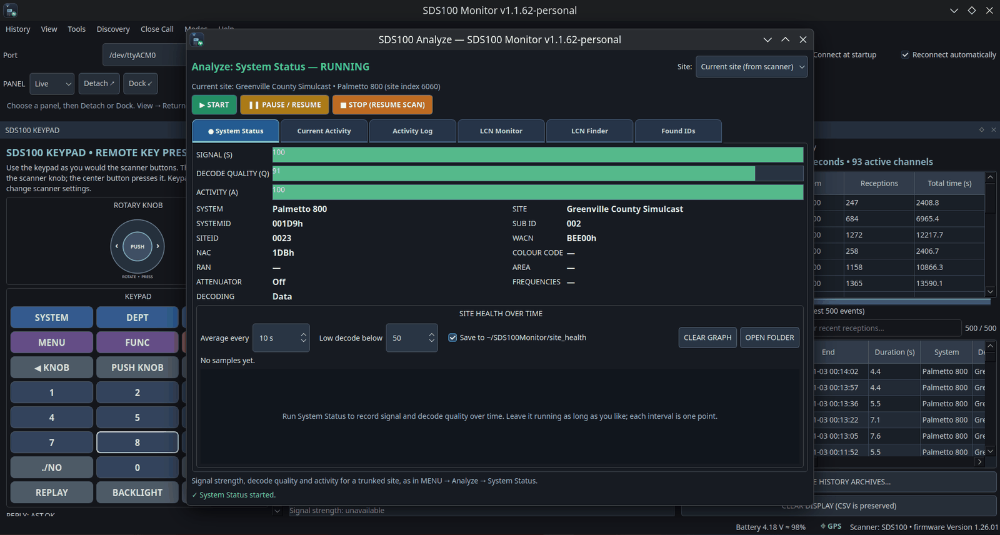

#### Site health over time

While System Status runs, S, Q and A are averaged over an interval and drawn on a graph, along with the **lowest Q** in each interval.

- **Average every** sets the interval (default 10 s).
- **Low decode below** (default 50) draws a line on the graph and counts the intervals that dropped below it, with the time of the last one.
- The summary shows how many intervals were recorded, average and lowest decode quality, average signal, and how often decode dropped low.
- **Save to ~/SDS100Monitor/site_health** writes one line per interval to `site_health_YYYY-MM-DD.csv`.
- **CLEAR GRAPH** starts the graph again.

> [!TIP]
> Leave System Status running for hours to see dropouts and time-of-day patterns, or to back up an Antenna Test with a longer run. On a simulcast system, **decode quality matters more than signal**.

### Current Activity

Every channel of the site, updated 5 times a second, with the columns LCN, frequency, type (control channel, talkgroup, patch, I-call…), talkgroup, talkgroup name (from your reception history), unit ID (with your name for it), mode (analog, digital, encrypted), system ID, site ID, **On air** (how long the current call has lasted) and **Last call**.

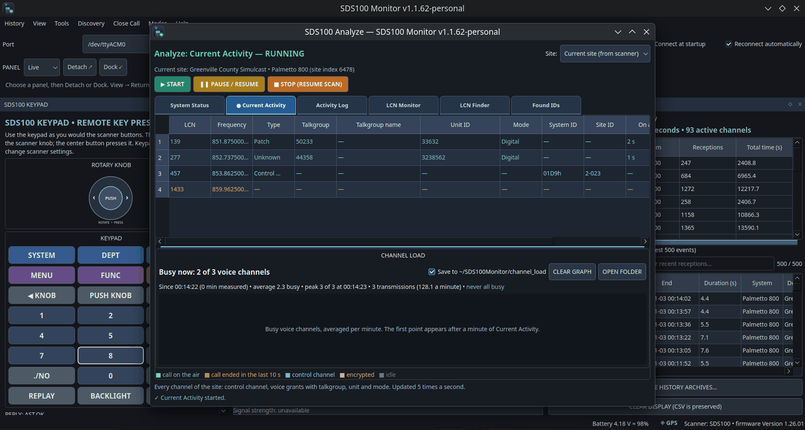

| Row colour | Meaning |
|---|---|
| Green | A call is on the air |
| Amber | A call ended in the last 10 seconds |
| Cyan | The control channel |
| Red | Encrypted call |
| Grey | Idle |
| Dark grey | The scanner has stopped reporting this channel |

Right-click a row to copy it, add an alert for its talkgroup, search for it, or use the unit actions (Name This Unit… and so on).

#### Channel load

Below the table, **CHANNEL LOAD** measures how busy the site is:
- **Busy now:** voice channels with a call on them right now, out of the total.
- Since the start: the average number busy, the **peak** (and when), **transmissions** and transmissions per minute, and how long **all voice channels were busy** at once.
- A graph of average and peak busy channels per minute, with a line for the total number of voice channels.
- **Save to ~/SDS100Monitor/channel_load** writes one line per minute to `channel_load_YYYY-MM-DD.csv`.

> [!NOTE]
> Right after Current Activity starts, the scanner lists only the channels it has seen so far. The program remembers the most channels each site has shown, so a short list doesn't count as "all busy".

### Activity Log

Decoded **control-channel messages**, with the scanner's time stamp, the message and its details: voice channel grants (channel, talkgroup and the unit talking), grant updates, patches, network and RFSS status broadcasts, identifier updates, and more.

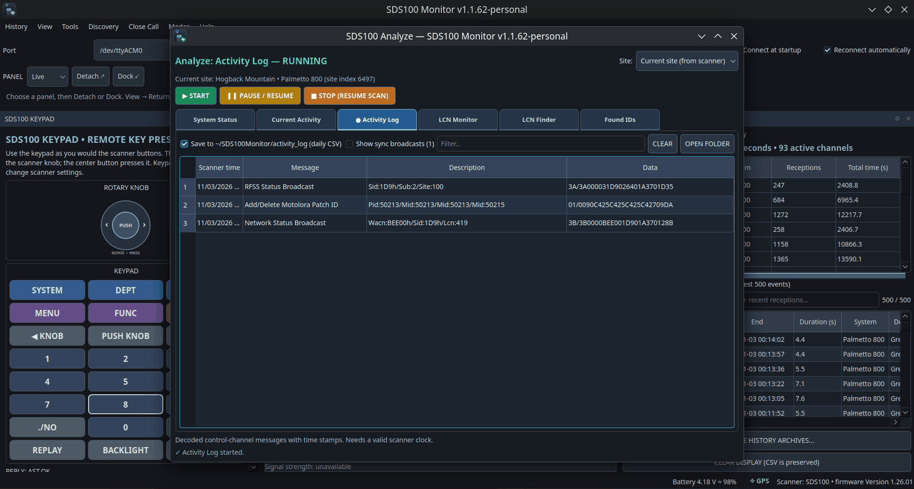

- **Save to ~/SDS100Monitor/activity_log** writes a daily CSV with PC time, scanner time, system, site, data, message and details.
- **Show sync broadcasts:** P25 synchronization (time) broadcasts arrive several times a second and carry only the time. The SDS100 labels them *"Add Harris Patch ID"*. They're hidden and not saved unless this is ticked; the count beside it shows how many were hidden.
- Lines the scanner sends twice are dropped. **Filter**, **CLEAR** and **OPEN FOLDER** are at the top.

The Activity Log needs a valid scanner clock (chapter 6).

### LCN Monitor

Each logical channel number (LCN) of the site, its frequency, and whether it is receiving, updated once a second.

### LCN Finder

Finds LCN numbers for **EDACS, LTR, MotoTRBO and DMR Tier III** systems. A 30-cell grid shows each LCN as unknown, level 1–4, found or disabled, with the frequency being checked and the overall condition. Save the results on the scanner when it finishes.

LCN Finder doesn't work on P25 systems, which send their own channel numbers; the scanner refuses it there and the program explains why.

### Found IDs

The **Found IDs** tab collects every **talkgroup** and **unit** seen in Current Activity and the Activity Log, including ones you don't scan. It is filled in while either of those runs, and kept between sessions.

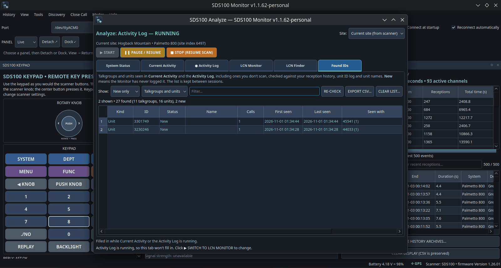

Columns: kind, ID, status, name, transmissions, first seen, last seen, **seen with** (the units a talkgroup was heard with, or the talkgroups a unit used), and notes (encrypted, patched with…, or the scanner showing the type as *Unknown*).

**Status** is checked against your reception history, unit ID log and unit names:

| Status | Meaning |
|---|---|
| **New** | The Monitor has never logged it |
| **Heard, no name** | A talkgroup in your history without a name |
| **Seen before** | A unit in your unit ID log without a name |
| **Named** | A talkgroup with a name in your history, or a unit you've named |

- **Show:** New only, Not named, or All; talkgroups, units or both; and a filter box.
- Right-click for **Name This Unit…** and the unit actions, **Alert When Talkgroup Is Active**, **Search Everything**, copy, and **Remove From List**.
- **RE-CHECK** re-reads history; this happens automatically when you open the tab and each new day.
- **EXPORT CSV…** saves the rows shown, and **CLEAR LIST…** starts over.
- The list is saved in `~/SDS100Monitor/analyze_found_ids.csv`.

Talkgroups are matched by number only, whatever the system.

## 16. Antenna Test

**Tools → Antenna Test…** compares antennas, mounts or positions on the same real signals.

> [!NOTE]
> The scanner's readings aren't calibrated, so this is an **A/B comparison** tool. Use the same scanner, coax and place, change only the antenna, and run the tests close together in time. It can't measure SWR, impedance or true gain; an antenna analyser such as a NanoVNA does that, and pairs well with this tool.

### References

The **References** tab lists the signals to measure, in order. Each has a type that sets how it's sampled:

| Type | Use and measurement |
|---|---|
| **P25 site (control channel)** | For a trunked site such as a simulcast. Scan or hold on the site, then **ADD CURRENT SITE**. The test runs the scanner's own Analyze → System Status and records **decode quality (Q)** and **signal (S)**. Optional **voice window**: afterwards it holds the site and counts calls and how many were decoded. |
| **Continuous signal** | A NOAA weather station: **ADD NOAA…**, or hold on it and **ADD CURRENT FREQUENCY**. Every reading during the hold is used, and the spread between strong and weak readings (fading) is reported. |
| **Bursty / repeater** | For example a VHF DMR repeater. Readings are only used while a signal is present, and transmissions are counted. Defaults to 20 minutes; give it 15–30. |
| **Noise floor** | An empty frequency in a band. Lower is better. Also shows how often something broke squelch there (interference). |

> [!TIP]
> For a simulcast system, **Q is the number that matters**. An antenna that hears more of the out-of-phase towers can show more signal and still decode worse.

Frequencies are tuned with Quick Search Hold. The run skips anything the scanner doesn't confirm within 15 seconds, and says so.

### Running a test

On the **Run** tab:
1. Give the run a **label**, such as *Antenna A* or *Roof mount 20 ft*, and add notes.
2. Press **START RUN**. Live readings, progress and per-reference results are shown as it goes.
3. **SKIP** keeps what the current reference has measured so far and moves on. **STOP** keeps everything measured.

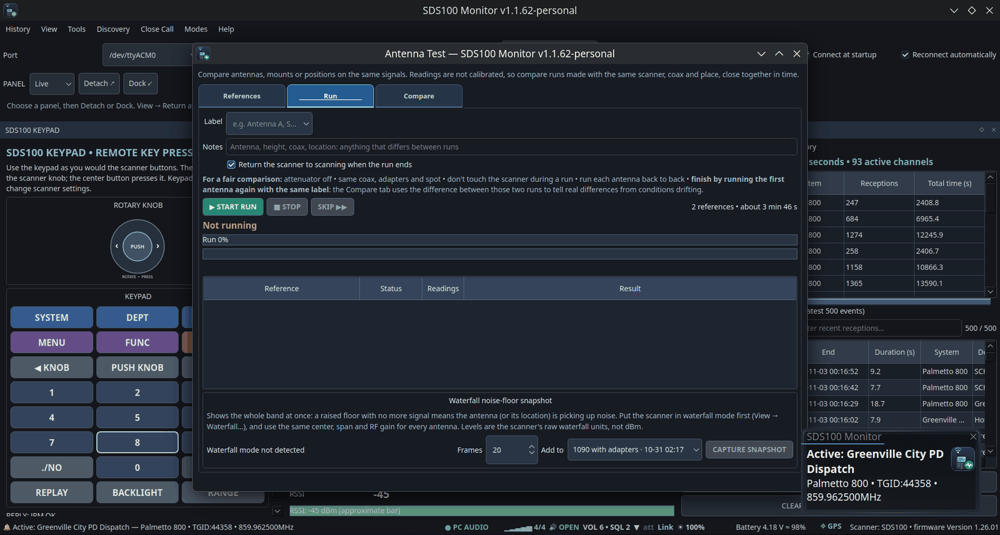

The scanner goes back to scanning at the end (optional). Every run is saved to `~/SDS100Monitor/antenna_tests` as it happens, including a stopped run or one cut off by a disconnect.

**Waterfall noise-floor snapshot:** with the scanner in waterfall mode on a band, **CAPTURE SNAPSHOT** averages 20 frames and adds them to the run. Use the same centre, span and RF gain for every antenna. Levels are the scanner's raw waterfall units, not dBm.

### Comparing

On the **Compare** tab, tick the runs to compare.

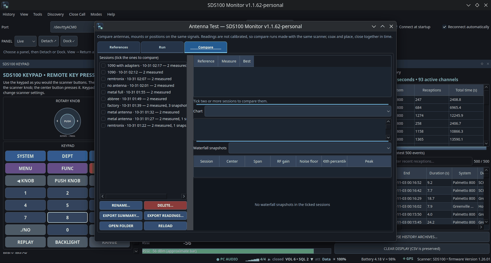

- Each reference gets a row per measure, with the difference from the oldest ticked run and a **Best** column.
- A difference only counts when it's bigger than about 2 dB (RSSI), 5 points (Q or S) or 20% (counts). Otherwise the result says *≈ no clear difference*.
- There's a grouped bar chart per measure, and overlaid waterfall traces for snapshots with the same centre and span.

**Drift check:** finish by running the first antenna again **with the same label**. The Compare tab measures how far those two runs differ, which is how much conditions changed on their own, and won't count any difference smaller than that.

**EXPORT SUMMARY…** saves one CSV row per run and reference with all measures. **EXPORT READINGS…** saves every reading.

## 17. GPS, Places and Map

### GPS: keeping the scanner's location updated

The SDS100 takes a GPS receiver on its USB port, but SDS100 Monitor uses that port for the PC connection, so the two can't share it. Instead, **Tools → GPS…** reads a GPS connected to the PC, and sets the scanner's location as you move. Location-based scanning then keeps working while the scanner is connected, for example on a laptop in a vehicle.

**GPS sources:**

| Source | Setup |
|---|---|
| **USB GPS receiver** | Most GPS pucks (u-blox, BU-353…) appear as `/dev/ttyACM0` or `/dev/ttyUSB0`. The scanner's own port is left out of the list. Speed is detected automatically (4800 to 115200 baud). If the port won't open, run `sudo usermod -aG dialout $USER`, then log out and in. |
| **Android phone (UDP)** | Install **GPSd Forwarder** (free, on F-Droid), enter the PC's address (shown in the dialog) and the UDP port (default 29998), and tap Start. The phone and PC must be on the same Wi-Fi. Any app that sends NMEA over UDP works. |
| **iPhone or other device (TCP)** | An NMEA app that runs a TCP server shows an address and port to enter. iOS stops such apps after a while in the background, so keep it open. |
| **gpsd** | If you already run gpsd (default `127.0.0.1:2947`). |

**How updates work:**
- The program first reads the scanner's location, to learn its number format and range.
- It then sends your position once you've moved **0.5 miles** (adjustable), and at least every **10 minutes** while moving, but never more often than every 30 seconds.
- The scanner's own range setting is kept unless you set one.
- Updates restart after a reconnect.

The **GPS** indicator in the status bar is green with a fix, amber while waiting for one or after losing it, and red on an error. Hover for position, speed, satellites and when the scanner was last updated; click it for the settings.

### Places and Map

**Tools → Places and Map…** picks out places mentioned in **transcripts** (chapter 10), looks them up, and shows them on a map.

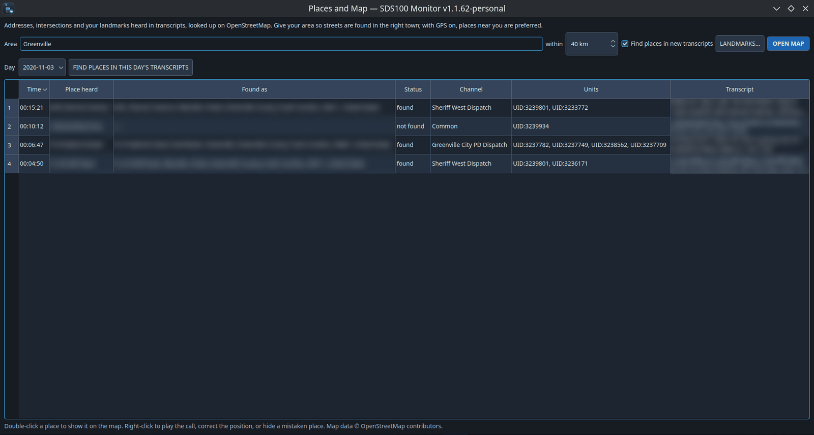

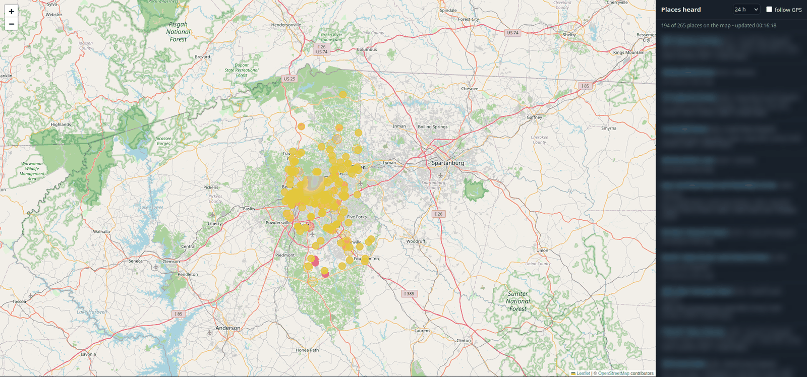

**What's found:**
- addresses (*400 Main Street*, *1234 N. Elm Ave*, *200 block of Smith Lane*);
- intersections (*Main and 5th*, *Route 40 at Oak Ridge Road*, *corner of Potomac Street and Franklin Street*);
- your **landmarks**.

Call signs such as *Engine 12 and Medic 4* aren't mistaken for intersections.

**Lookups:** addresses are looked up with OpenStreetMap's Nominatim, and intersections with OpenStreetMap's Overpass, which finds where the two streets actually meet. If no meeting point is found, the place is put on the first street and marked **approximate** (dashed on the map). Lookups are cached in `~/SDS100Monitor/geocode_cache.json` and kept to one a second, as the services ask.

**Area:** set your **Area** (e.g. *Hagerstown, MD*) and a radius. With GPS on, places near you are preferred; otherwise places near the scanner's location.

**Landmarks:** one per line, as `Name = latitude, longitude`, for example:

`North High School = 39.6512, -77.7134`

Saved places from Scanner Tools → Location count automatically. Right-click a found place → **Add as Landmark…** to reuse a corrected position.

**The Places window** lists the places for each day: time, place heard, what it was found as, status, channel, units and transcript.
- Double-click a place to show it on the map.
- Right-click for **Play Call**, **Open in OpenStreetMap**, **Copy Position**, **Correct Position…** and **Not a Place** (hides it).
- **FIND PLACES IN THIS DAY'S TRANSCRIPTS** processes older days. New transcripts are checked automatically (this can be turned off).

**The map** opens in your web browser. It's served by the program on this computer only, protected by a random key in its address.
- Markers are coloured by age: red under 1 hour, orange under 6 hours, yellow under 24 hours, blue older.
- Click a marker for the time, channel, units and transcript, and ▶ **Play** to hear the call.
- A side list shows the newest places first; click one to zoom to it.
- Show the last 1 hour to 7 days.
- Your GPS position and the scanner's location range are shown, with **follow GPS** to keep the map centred on you.
- The map refreshes every 10 seconds.

Map tiles come from openstreetmap.org (© OpenStreetMap contributors). Places and Map needs transcription, and an internet connection for lookups and tiles.

Places are saved in `~/SDS100Monitor/places/places_YYYY-MM-DD.csv`.

## 18. Macro keypad

SDS100 Monitor can be controlled from a cheap USB **macro keypad**: the "MINI KeyBoard" pads with 1–16 keys and 0–3 knobs, which show up as `1189:8890` in `lsusb`. **Tools → Macro Keypad…** sets it up.

### One-time setup

In the installed program folder, run:

`sudo bash install_keypad_rule.sh`

Then unplug the keypad and plug it back in. This lets your user read and program the keypad without `sudo`. Without it, the keypad only works while an SDS100 Monitor window is the active window. The window's **SETUP HELP** button shows the same steps.

### Working in the background

The program reads the keypad directly, so its keys work while another window is in front. With **Keypad keys go only to the Monitor** ticked (the default), the keypad stops typing into other programs while SDS100 Monitor is running. It goes back to normal when the program closes.

### Programming the keypad

**PROGRAM KEYPAD…** gives every key and knob action its own code, so each one can do something different:

- Keys 1–12 send F13–F24.
- Keys 13–16 send Ctrl+F13–F16.
- Knob turns and presses send Shift+F13–F21.

It uses the keypad's own configuration protocol, reads the number of keys and knobs from the pad, and asks before writing.

> [!CAUTION]
> Programming replaces whatever the keys did before, including settings made with other keypad tools.

**LEARN:** if your keypad is already programmed the way you like (for example with media keys on a knob), click **LEARN** on a row and press the key. Whatever the key sends is recorded. Two rows can't share the same key.

### Actions

Each key or knob action can be set to:

- **Scanner control:** resume scan, channel, system or department hold, previous or next, temporary avoid and remove avoid (each with or without a confirmation question), weather scan.
- **Audio:** volume up/down, mute, squelch up/down, recording on the scanner, PC audio capture on/off.
- **Scanner keys:** any scanner key, including the knob ◀ / push / ▶, and FUNC combinations (attenuator, IF Exchange, display, priority, search keys, FUNC + hold 4/9/REPLAY).
- **Waterfall** controls.
- **Windows:** open the waterfall, Scanner Screen or Analyze; bring SDS100 Monitor to the front.
- **Connection:** connect or disconnect.

**Default actions:**

| Key or knob | Action |
|---|---|
| Key 1 | Resume scan |
| Key 2 | Channel hold |
| Key 3 | Temporary avoid (asks first) |
| Key 4 | System hold |
| Key 5 | Department hold |
| Keys 6 / 7 | Previous / next channel |
| Key 8 | Recording |
| Key 9 | REPLAY |
| Key 10 | FUNC |
| Key 11 | MENU |
| Key 12 | E/YES |
| Knob 1 | Volume (press mutes) |
| Knob 2 | Squelch |
| Knob 3 | The scanner's knob |

Change any of them in the window; **DEFAULT ACTIONS** puts them back.

When you press a keypad key, the window highlights its row and shows what was sent and what it did. The status bar shows every keypad action, unassigned keys, and presses that were ignored because the scanner isn't connected or a dialog is open.

## 19. Themes and text size

**View → Theme** changes how the program looks. Changes apply straight away to every open window and are remembered.

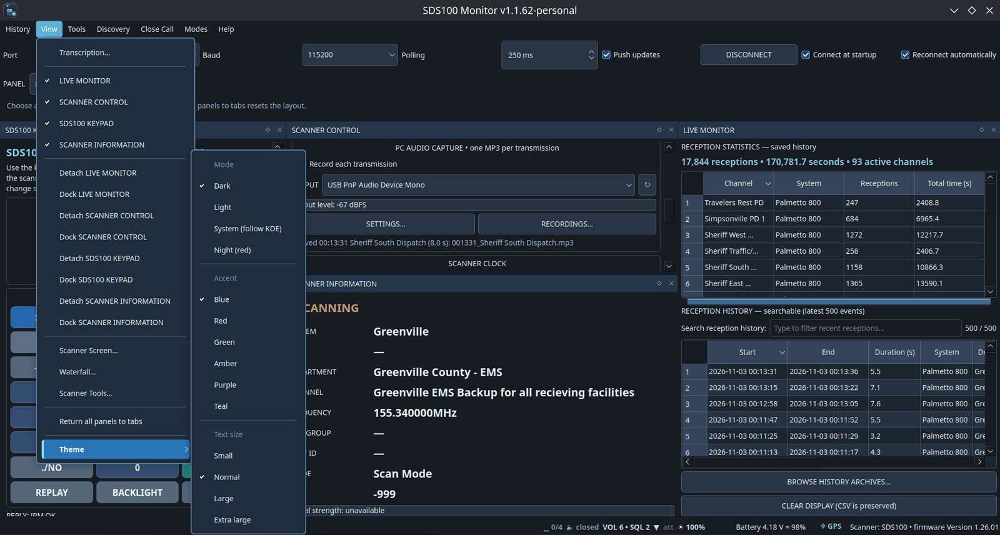

### Mode

| Mode | Description |
|---|---|
| **Dark** | Dark backgrounds with light text (the original look). |
| **Light** | Light backgrounds with dark text. Status colours are darker shades, so they stay readable. |
| **System (follow KDE)** | Light or Dark to match your KDE colour scheme. The program checks KDE's settings every few seconds, so switching KDE between Breeze and Breeze Dark switches SDS100 Monitor too. |
| **Night (red)** | Everything in dim shades of red, including charts, the Scanner Screen mirror and the waterfall, to keep your night vision. Things are told apart by brightness instead of colour. |

### Accent

**Blue** (the original), **Red**, **Green**, **Amber**, **Purple** or **Teal**. The accent colours tabs, menu highlights, splitters, the blue buttons and the slight tint of the backgrounds. Accent buttons keep the brightness of the blue they replace, so white text on them stays readable. Accents don't apply in Night mode.

### Text size

**Small**, **Normal**, **Large** or **Extra large**. This scales all text, including chart labels and the Scanner Information panel.

### What stays the same

- **Status colours** keep their meaning in every theme: green is good or active, amber a warning or recent, red bad or encrypted, cyan a control channel or information.
- **Coloured action buttons** (START, STOP, AVOID…) keep their colours and white text.
- The **Scanner Screen** mirror keeps the scanner's own display colours, except in Night mode.
- The **waterfall** keeps its signal-strength colour scale, except in Night mode.

> [!NOTE]
> Lines already in a log window (such as the Command Console) are recoloured when you change theme; it can take a moment with a long log.

## 20. Weather Alert, Tone-Out and scanner recordings

The **Modes** menu runs two of the scanner's special modes from the PC, with alerts, and plays the recordings stored on the scanner. **Modes → Weather and Tone-Out…** opens a window with both modes and the alerts heard.

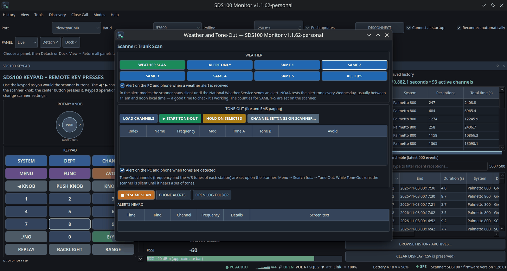

### Weather Alert

**WEATHER SCAN** listens to NOAA Weather Radio. The alert modes keep the scanner silent until the National Weather Service sends an alert:

| Mode | Wakes up for |
|---|---|
| **ALERT ONLY** | Any alert tone (1050 Hz) or SAME alert |
| **SAME 1–5** | Alerts for the counties in that SAME group, set up on the scanner (Menu → Weather Operation → Weather Alert → SAME) |
| **ALL FIPS** | A SAME alert for any county |

When an alert comes in (the scanner opens its audio, or shows an alert pop-up), the program shows a **desktop notification**, sends a **phone alert** if you've set them up (chapter 12), and logs it with the scanner's alert text. Repeats of the same alert are held back for 10 minutes.

> [!TIP]
> NOAA tests the alert tone every Wednesday, usually between 11 am and noon local time. That's a good time to check that alerts reach you.

### Tone-Out

Tone-Out listens for the two-tone pages that wake up fire and EMS stations.

- **LOAD CHANNELS** reads your Tone-Out channels from the scanner: name, frequency, and tones A and B.
- **▶ START TONE-OUT** (or **Modes → Start Tone-Out**) monitors all of them. **HOLD ON SELECTED** monitors one. **CHANNEL SETTINGS ON SCANNER…** opens that channel's menu on the scanner.
- When the scanner hears a page, you get a desktop notification and a phone alert, for example *Tone-Out: Station 5 • 154.4300 MHz • Tones 1135.5 / 832.5*. At most one alert per channel per minute.

Weather and Tone-Out alerts are listed under **ALERTS HEARD** and saved in `~/SDS100Monitor/mode_alerts/mode_alerts_YYYY-MM-DD.csv`. Phone Alerts has a category for each (**Tone-Out**, **Weather alerts**), on by default.

These modes' transmissions also go into reception history (System *Tone-Out*, *Weather* or *Close Call Hits*), so PC audio capture records a page and transcription transcribes it.

### Scanner recordings

**Modes → Scanner Recordings…** lists the recording folders on the scanner's SD card and the recordings in each, plus the scanner's replay recordings.

- **▶ PLAY**, or double-click, plays a recording **on the scanner** (through its own speaker or headphone jack).
- **◀ PREVIOUS**, **NEXT ▶** and **■ STOP (RESUME SCAN)** are beside it, and the top line shows what the scanner is playing.

## 21. Ten codes

Ten codes differ from agency to agency, so the same code can mean different things on two channels you listen to. **Tools → Ten Codes…** keeps several lists, and says where each one applies.

### Where a list applies

Each list has:
- **Agencies:** words matched against the system, department or channel being received, for example *Greenville* or *Highway Patrol*. A list whose agency you are hearing is used first.
- **Area:** a centre and a range in miles, like the scanner's location control. Lists covering your location come next, the smallest area first.
- Lists with **no area** apply anywhere. They come last.

Your location comes from the GPS (chapter 17), then the scanner's own location setting, then **MY LOCATION…** in the window.

### The Ten Codes window

The top line shows your location and the agency last heard.

- **Show:**
  - *Best match here* lists each code once, from the best list.
  - *All lists that apply here* shows every applicable list's meaning side by side, the best in bold.
  - Or choose a single list.
- **Search** by code (`10-50`, or just `50`) or by words (*accident*).
- **Follow what's heard** switches lists by itself when the scanner moves to another agency.
- The line under the table says which lists are being used and why.

### Editing lists

**EDIT LISTS…** opens the list editor:
- **NEW LIST**, **DUPLICATE**, **DELETE**, and tick boxes to turn lists on or off.
- **Name**, **Source**, **Agencies** (comma-separated words) and **Area** (**Only near** with latitude, longitude and range; **USE CURRENT LOCATION** fills them in).
- The codes: **Code**, **Meaning** and **Details**. Sub-codes go in Details separated by semicolons, for example `B. Personal injury; C. Hit and run`.
- **IMPORT CSV…** and **EXPORT CSV…** use the columns Code, Meaning, Details.
- **RESTORE BUILT-IN LISTS** puts back the lists that came with the program, as they came.

The program comes with the **APCO standard (1974)** ten signals, which applies anywhere. Add your local agencies' codes as your own lists. They're kept in `~/SDS100Monitor/ten_codes.json`.

### Decoding in transcripts

The Transcription window decodes codes heard in calls (chapter 10). It recognises `10-50`, `10 50`, `ten fifty`, `10-50B`, `10-50 B`, `10-50 bravo` and `signal 4`. A bare `1050` is left alone, because it's usually an address.

> [!NOTE]
> Ten codes change, and some agencies have dropped them for plain language. Check the lists against what you actually hear.

## 22. Daily reports

**History → Daily Report…** sums up one day on one page:

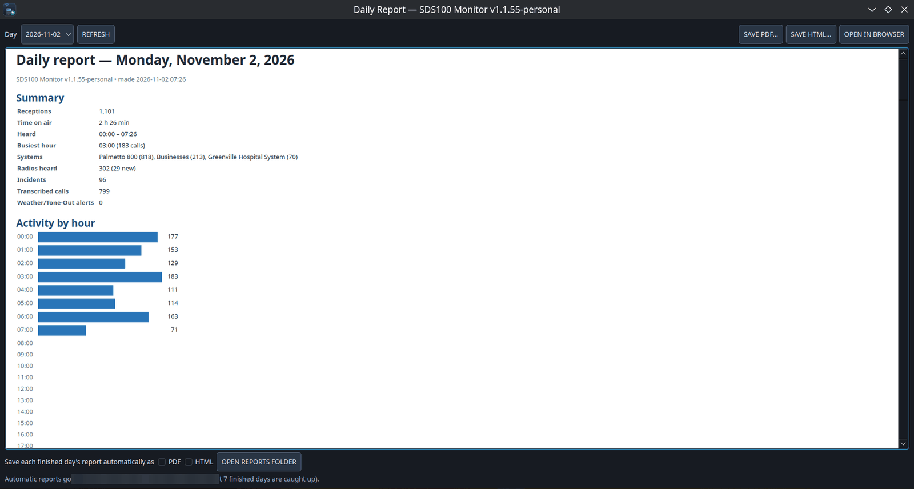

- **Summary:** receptions, time on air, first and last call, the busiest hour, systems, radios heard (and how many are new), incidents, transcribed calls, and Weather/Tone-Out alerts.
- **Activity by hour**, as a bar chart.
- **Busiest talkgroups and channels**, with calls and time on air.
- **Incidents**, each with its headline (chapter 12).
- **Ten codes heard**, with how often.
- **Most active radios**, and **radios not heard in the previous 30 days**.
- **Places mentioned**, linked to OpenStreetMap.
- **Weather and Tone-Out alerts**.

Choose the day at the top. **SAVE PDF…** and **SAVE HTML…** save the report you're looking at; **OPEN IN BROWSER** opens it in your web browser.

**Automatic reports:** tick **PDF**, **HTML** or both under *Save each finished day's report automatically as*. After midnight each finished day's report is saved to `~/SDS100Monitor/reports/daily_report_YYYY-MM-DD.pdf` (or `.html`). If the program was closed for a while, it catches up on the last 7 days. **OPEN REPORTS FOLDER** shows them.

> [!NOTE]
> Incidents and ten codes are worked out automatically, so the report can be wrong in the details. It says so at the bottom of the page.

## 23. Updates, About and the project page

### Check for Updates

**Help → Check for Updates…** looks for a newer version in two places:
- the project's **GitHub releases** (github.com/jmlynchjr/SDS-MONITOR), which you can change or clear in the window;
- your **Downloads** folder, for a newer `sds100-monitor_<version>_all.deb`.

If it finds one, it shows what's new.
- **INSTALL** installs it. The system asks for your password, and the window won't close half-way through. When it's done, it offers to restart SDS100 Monitor.
- **SKIP THIS VERSION** stops it offering that version at start-up.

The program also checks quietly 20 seconds after it starts. If there's an update, **⬆ Update … available** appears in the status bar; click it to see the update. Untick **Check when the Monitor starts** to stop that.

### About and the project page

**Help → About SDS100 Monitor** shows the version, the author and licence, and the Python and Qt versions. Include those when you report a problem. **Help → Project Page** opens the project on GitHub, where problems can be reported as *Issues*.

## 24. Testing the program

SDS100 Monitor comes with its own automated tests, about 100 of them, which check that its parts still work: the windows, the connection, push updates against a simulated scanner, the battery reading, reception logging, transcripts, Weather and Tone-Out alerts, GPS, alerts and search, themes, ten codes, reports, the update check and the install scripts. To run them:

`bash /opt/sds100-monitor/run_tests.sh`

(or `bash run_tests.sh` in a folder install). It takes a few seconds. Add `-v` to list each test by name. It ends with **OK**, or lists what failed.

- The tests never touch your real reception history, settings or scanner. Every test works in its own throw-away home folder, and no serial port is opened.
- Most tests run on a stand-in for Qt, so they run anywhere.
- With PyQt6 installed (it is with the package), two more tests start the **real program on the real Qt**, invisibly. One triggers every menu command, opens every window and switches themes; the other starts and closes the program, and fails on any crash.

> [!TIP]
> Run the tests after installing a new version, and on a new computer such as a Raspberry Pi. If anything fails, include the output when you report it.

## 25. Raspberry Pi

SDS100 Monitor runs on a Raspberry Pi. That makes a small, quiet, always-on scanner station: the Pi sits beside the scanner, records and logs every call, and you can check it from your desk or phone.

> [!NOTE]
> The program is written for and tested on Kubuntu. It isn't Pi-specific, and nothing in it needs a newer Qt or Python than Raspberry Pi OS provides, but it hasn't been tested on a Pi yet. Run the tests (step 6 below) to check your setup.

### Which Pi

| Pi | Monitoring, history, recording, reports | Transcription |
|---|---|---|
| **Pi 5** (4 or 8 GB) | Comfortable | Works. 8 GB recommended for the *small.en* model; each call takes longer than on a desktop PC |
| **Pi 4** (4 or 8 GB) | Comfortable | Use *tiny.en* or *base.en*: faster, less accurate |
| **Pi 3** or older | Usable, slowly | Turn it off |

Use **Raspberry Pi OS 64-bit, with desktop** (Bookworm or newer), on a good microSD card or, better, a USB SSD: the program writes history and recordings all day.

### Setting up

1. Install Raspberry Pi OS (64-bit, with desktop) with the Raspberry Pi Imager, start the Pi, and finish its first-run setup.
2. Bring it up to date:

   `sudo apt update && sudo apt full-upgrade`

3. Download `sds100-monitor_<version>_all.deb` on the Pi (from the releases page in its web browser), and install it in a terminal, in the folder you downloaded it to:

   `sudo apt install ./sds100-monitor_1.1.62_all.deb`

   The package is the same one as for a PC: it's pure Python, marked *all* for every processor.

4. Let your user use the scanner's serial port, then log out and back in:

   `sudo usermod -aG dialout $USER`

5. Connect the SDS100 by USB, choose **Serial Port** on the scanner, start **SDS100 Monitor** from the menu, choose the port (usually `/dev/ttyACM0`) and **CONNECT**.
6. Check the installation:

   `bash /opt/sds100-monitor/run_tests.sh`

### Audio on a Pi

The Pi has no line-in. For PC audio capture (chapter 9) use a **USB sound card** with a microphone or line input, connected to the scanner's headphone jack. Choose it as the input in PC AUDIO CAPTURE and set the levels as on a PC. The package installs `ffmpeg` and Qt Multimedia.

### Transcription on a Pi

Install the engine as on a PC (chapter 10; it needs `sudo apt install python3-venv` first). Then, in **Transcription → SETTINGS…**:
- choose a smaller model on a Pi 4 (*tiny.en* or *base.en*);
- keep **Unload the model after** set (a few minutes), so the engine frees its memory between busy periods.

Calls queue up and are transcribed in order, so a slower Pi falls behind during busy periods and catches up later.

### Running it unattended

- **Start with the desktop:** copy the menu entry into the autostart folder:

  `mkdir -p ~/.config/autostart && cp /usr/share/applications/sds100-monitor.desktop ~/.config/autostart/`
- **Connect by itself:** tick **Connect at startup** and **Reconnect automatically** (chapter 3).
- **Reports and alerts:** turn on automatic daily reports (chapter 22) and phone alerts (chapter 12), so you hear about the day without opening the Pi.
- **Keep the screen awake** if it shows the monitor, or run the Pi without a screen and connect with VNC (Raspberry Pi Configuration → Interfaces → VNC).
- **Power and storage:** use the official power supply (a weak one causes USB dropouts), and check free space from time to time, since recordings add up.
- **GPS:** a USB GPS receiver works the same way as on a PC (chapter 17), which suits a Pi in a vehicle.

### Theme and browser

The Pi's desktop isn't KDE, so the **System** theme follows Qt's own light or dark setting instead. Reports and maps open in the Pi's Chromium or Firefox.

## 26. Aircraft (ADS-B)

If you also run an ADS-B receiver on the same PC, with **readsb** or **dump1090** and an RTL-SDR dongle, the Monitor can read its aircraft list. It then alerts on emergency squawks and watched aircraft, and works out which aircraft go with the callsigns heard in airband transcripts. It works alongside tar1090 and graphs1090, which you don't need to change.

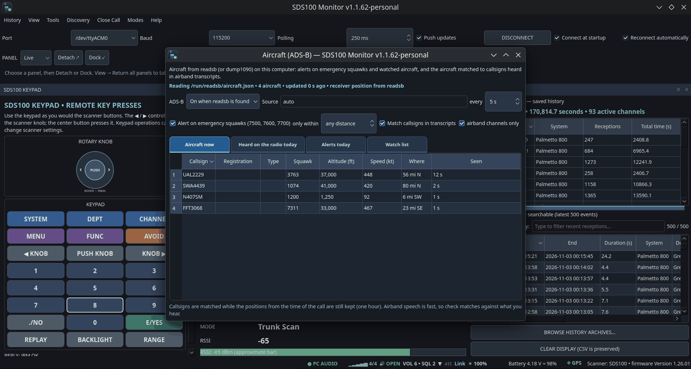

Open it with **Tools → Aircraft (ADS-B)…**.

### Setup

There is usually nothing to set up. With **ADS-B** set to **On when readsb is found** (the default), the Monitor looks for readsb's `aircraft.json` in `/run/readsb/` and the usual dump1090 locations, and starts on its own when it finds one. The status line at the top shows what it is reading, how many aircraft there are and your receiver's position.

| Setting | What it does |
|---|---|
| **ADS-B** | **On when readsb is found**, **On** or **Off**. |
| **Source** | **auto**, a path to an `aircraft.json` file, or an address such as `http://127.0.0.1/tar1090/data/aircraft.json` (tar1090's copy, also from another computer on your network). |
| **every** | How often the list is read, 2 to 60 seconds (default 5). |

Distances are measured from the receiver position readsb reports (`receiver.json`). If readsb has no position, distances are left blank.

### Emergency squawks

With **Alert on emergency squawks** ticked, you get a desktop alert when an aircraft squawks **7700** (emergency), **7600** (radio failure) or **7500** (hijack), or reports an emergency status. The alert gives its callsign, registration, type, altitude, speed and distance. **only within** limits alerts to a distance, in miles; 0 means any distance. Each aircraft and code is alerted at most once every 30 minutes.

To get these on your phone, tick **Aircraft** in **Tools → Phone Alerts…** (chapter 12).

### Watch list

The **Watch list** tab takes one entry per line:

- a callsign, such as `DAL1234`;
- a registration, such as `N123AB`;
- an ICAO hex code, such as `a1b2c3`;
- a start followed by `*`, such as `N911*` or `RCH*`.

Press **SAVE WATCH LIST**. You get an alert when a watched aircraft is seen, at most once every two hours for each one.

### Callsigns in airband transcripts

With **Match callsigns in transcripts** ticked, each airband transcript (chapter 10) is searched for callsigns, for example:

- *Delta twelve thirty-four* (DAL1234);
- *Southwest 2 2 1 1* (SWA2211);
- *November one two three alpha bravo* (N123AB);
- *Cessna four five alpha*.

About 70 airline and operator radio names are known. A callsign found is matched against the aircraft in range at the time of the call. Positions are kept for an hour, so slow transcriptions still match.

Matches are shown under the transcript in the Transcription window (callsign, registration, type, altitude, speed and distance) and in the **Heard on the radio today** tab. A callsign that ADS-B didn't see is still listed, without aircraft details.

**airband channels only** (on by default) limits matching to 108–137 MHz and 225–400 MHz.

> [!TIP]
> Airband speech is fast and clipped, and transcription isn't perfect. Treat a match as a strong hint, and check it against what you hear.

### The tabs

| Tab | Shows |
|---|---|
| **Aircraft now** | Every aircraft in the list: callsign, registration, type, squawk, altitude, speed, distance and direction, and when it was last seen. |
| **Heard on the radio today** | Callsigns found in today's transcripts and the aircraft they were matched to. |
| **Alerts today** | Today's squawk and watch-list alerts. |
| **Watch list** | Your watched aircraft. |

Alerts and matches are saved in `~/SDS100Monitor/adsb/`, one file of each per day (chapter 27).

## 27. Files and folders

All data is kept in your home folder, mostly under `~/SDS100Monitor`. Everything is plain CSV, JSON or MP3, so it can be opened in a spreadsheet or other programs, and backed up by copying the folder.

| File or folder | Contents |
|---|---|
| `~/SDS100Monitor/history/reception_history_YYYY-MM-DD.csv` | Reception history, one file per day (chapter 5) |
| `~/SDS100Monitor/reception_history_v6.csv` | Legacy history file from early versions (read-only) |
| `~/SDS100Monitor/unit_ids/unit_ids_YYYY-MM-DD.csv` | Unit ID log (chapter 11) |
| `~/SDS100Monitor/unit_names.csv` | Your unit names, status and notes |
| `~/SDS100Monitor/audio/YYYY-MM-DD/` | PC audio capture MP3s, `recordings_…csv` index and `transcripts_…csv` (chapters 9–10) |
| `~/SDS100Monitor/transcribe-engine/` | The transcription engine's own Python environment |
| `~/SDS100Monitor/activity_log/activity_log_YYYY-MM-DD.csv` | Analyze Activity Log (chapter 15) |
| `~/SDS100Monitor/site_health/site_health_YYYY-MM-DD.csv` | Site health over time |
| `~/SDS100Monitor/channel_load/channel_load_YYYY-MM-DD.csv` | Channel load per minute |
| `~/SDS100Monitor/analyze_found_ids.csv` | Found IDs |
| `~/SDS100Monitor/close_call_frequencies.json` | Close Call names, notes and statuses (chapter 14) |
| `~/SDS100Monitor/antenna_tests/` | Antenna Test runs (chapter 16) |
| `~/SDS100Monitor/places/places_YYYY-MM-DD.csv` | Places found in transcripts (chapter 17) |
| `~/SDS100Monitor/geocode_cache.json` | Cached address lookups |
| `~/SDS100Monitor/mode_alerts/mode_alerts_YYYY-MM-DD.csv` | Weather and Tone-Out alerts (chapter 20) |
| `~/SDS100Monitor/ten_codes.json` | Your ten-code lists (chapter 21) |
| `~/SDS100Monitor/reports/` | Saved daily reports (chapter 22) |
| `~/SDS100Monitor/adsb/adsb_alerts_YYYY-MM-DD.csv` | Aircraft squawk and watch-list alerts (chapter 26) |
| `~/SDS100Monitor/adsb/aircraft_heard_YYYY-MM-DD.csv` | Callsigns matched in transcripts (chapter 26) |
| `~/.config/SDS100Monitor/` | Program settings: window layout, options, alert rules, theme, phone alerts, update check |
| `/opt/sds100-monitor/` | The installed program (package); `/usr/bin/sds100-monitor` starts it |
| `~/SDS100Monitor-<version>/` | A folder install (older versions, or without the package) |

Existing CSV files are never rewritten in a new format. New features add new files instead of changing old ones.

## 28. Troubleshooting

### Connecting

**CONNECT says permission denied.** Add yourself to the `dialout` group with `sudo usermod -aG dialout $USER`, then log out and back in.

**No port is listed, or `/dev/ttyACM0` isn't there.** Check that the scanner is on and the USB cable carries data (some cables only charge). If the scanner asks how to connect, choose the serial port mode, not mass storage. Unplug and replug, and click CONNECT again.

**The program says another program has the port open.** Close the other program (for example Sentinel under Wine, a terminal program, or a second copy of SDS100 Monitor). Only one program can use the scanner's port at a time.

**The connection keeps dropping.** Try another USB port or cable, and avoid unpowered hubs. With **Reconnect automatically** ticked, the program reconnects by itself, even if the port name changes.

### Scanner functions

**Discovery won't start.** Set the scanner's clock with **SET CLOCK FROM PC** (chapter 6). The scanner won't enter Discovery with a temporarily set clock. Also check that the session exists on the scanner.

**The Activity Log in Analyze stays empty.** Make sure Activity Log is the function actually running: its tab should show **●**. If another function is running, use **▶ SWITCH TO ACTIVITY LOG**. The Activity Log also needs a valid scanner clock.

**LCN Finder is refused.** It only works on EDACS, LTR, MotoTRBO and DMR Tier III systems, not P25.

**Analyze shows nothing.** Scan or hold on the trunked system first, so the scanner has loaded it, and check the site index.

**Setting the Close Call mode stops in the Scanner Menu window.** The scanner's menu didn't look as expected, so the program stopped instead of guessing. Finish the choice in that window.

**The battery reading doesn't change.** It's read from the scanner's screen, which only shows `Batt:` on some views (chapter 4). The last reading stays until the screen shows it again.

**Push updates fall back to polling.** The status bar's tooltip says why. Make sure nothing else sends `PSI` commands (the Command Console), then tick Push updates again.

### Audio and transcription

**PC audio capture records nothing.**
- Check the input chosen in PC AUDIO CAPTURE.
- Check the level meter while the scanner is receiving; the scanner's volume must be up.
- Check the skip reason shown in the panel: too short, or below the silence level.

**Recordings are distorted.** Lower the scanner's volume until speech peaks around −12 to −3 dBFS.

**Transcription doesn't start.** Install `python3-venv`, then use **INSTALL ENGINE** in Transcription → SETTINGS…. The first call after installing or changing model waits for the model to download.

**Transcripts are poor.** Add your agencies' unit names, streets and codes to **Vocabulary**. Try a larger model if your PC can handle it. Digital voice and weak signals transcribe less well.

### Starting, closing and installing

**The program sometimes crashes as it starts** (segmentation fault; the system's crash report mentions PipeWire). That was a fault in Qt 6.10's new PipeWire audio backend. Since version 1.1.55 the program uses Qt's PulseAudio backend, which PipeWire also serves. Update to the current version.

**A segmentation fault when closing.** Fixed in 1.1.49 (a crash in Python's own shutdown with PyQt6 on Python 3.14). Update to the current version.

**No icon in the application menu after installing.** Fixed in 1.1.54 (the package now refreshes the icon caches). For an older package, run `sudo gtk-update-icon-cache -f /usr/share/icons/hicolor` and `kbuildsycoca6 --noincremental`, or log out and back in.

**apt prints "Download is performed unsandboxed as root".** Harmless; see chapter 2.

**Reports or the map open nothing, or ask for /snap/firefox.** The program opens web pages in a browser that isn't a snap: the one in `$BROWSER` if set, otherwise the apt Firefox, Chromium and so on. If your desktop's own default still points at a removed snap, choose your browser again in the system settings (on KDE: System Settings → Default Applications).

**Check for Updates can't install.** It needs `pkexec`, which Kubuntu and Raspberry Pi OS include. Without it, the window shows the `sudo apt install …` command to run instead.

### Other

**The macro keypad types into other programs, or only works when the Monitor is in front.** Run `sudo bash /opt/sds100-monitor/install_keypad_rule.sh`, then unplug and replug the keypad.

**The GPS port won't open.** Add yourself to `dialout` as above. For a phone, check that it's on the same Wi-Fi as the PC, and that the port number matches.

**The window layout is a mess.** Use **View → Return all panels to tabs**.

**Aircraft (ADS-B) says readsb wasn't found.** Check that readsb is running (`systemctl status readsb`) and that `/run/readsb/aircraft.json` exists. With a different program or location, enter the path or tar1090's address in **Source**.

**Aircraft distances are blank.** readsb doesn't know where the receiver is. Set its latitude and longitude (for readsb, `sudo readsb-set-location <lat> <lon>`), then restart readsb.

**The Scanner Menu doesn't respond after changing the lists to monitor.** The scanner is loading the lists, which can take several seconds. Wait, then press **REFRESH**.

**Something looks wrong and you want to report it.** Open **Tools → Command Console…**, tick **XML replies** (and **Status polls** if it involves the status report), repeat what went wrong for a few seconds, and **SAVE…** the log. That file shows exactly what the scanner sent.

## Appendix: Commands that depend on the scanner's firmware

Uniden's *Remote Command Specification V2.00* doesn't fully describe every reply. For these, the program checks what the scanner actually does, and falls back or explains if it differs:

| Feature | How the program handles it |
|---|---|
| **Tune to frequency** (`QSH`) | Tries 100 Hz units first, then MHz, and remembers which the scanner accepted. |
| **Scanner location** (`LCR`) | Reads the location first to learn the number format, then sends changes in that format. |
| **Go to number tag** (`JNT`) | Sends blank tags as blank; if refused, enter all three tags. |
| **Start waterfall** (`JPM,WF_MODE`) | Marked as reserved in the specification; use the FUNC + search key method if it's refused. |
| **Close Call mode** | No direct command; set through the scanner's menu by item names, stopping in the Scanner Menu window if anything is unexpected. |
| **Scanner Menu settings** (`MSV`/`MSB`) | The first field isn't defined; sent blank, then `0` if refused, and the working form is remembered. |
| **Battery** (`GCS`) | Refused by the SDS100 (firmware 1.26.01); after two refusals the voltage is read from the scanner's screen (`GST`). |
| **Push updates** (`PSI`) | The interval is in milliseconds (confirmed on an SDS100); if pushed reports stop, one retry, then polling. |
| **RF Power Plot** | Not available on the SDS100 (removed in its firmware); the program doesn't offer it. |
| **Screen mirror** (`GST`) | Falls back to `STS` if refused. |
| **Analyze stop** | The specification has no stop command; STOP returns the scanner to scan mode (`JPM,SCN_MODE`). |
